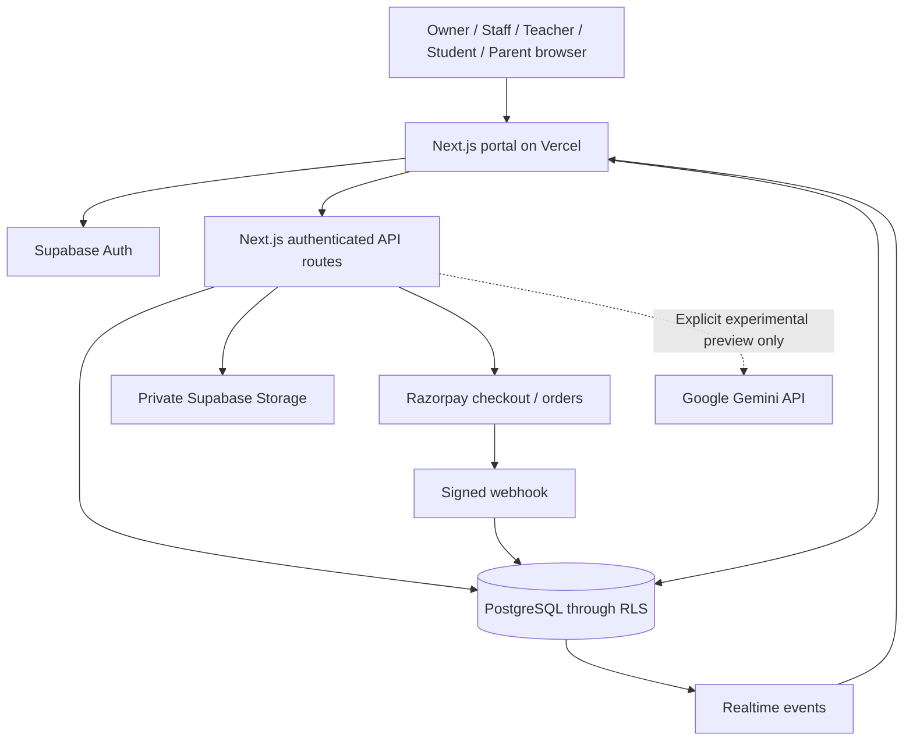
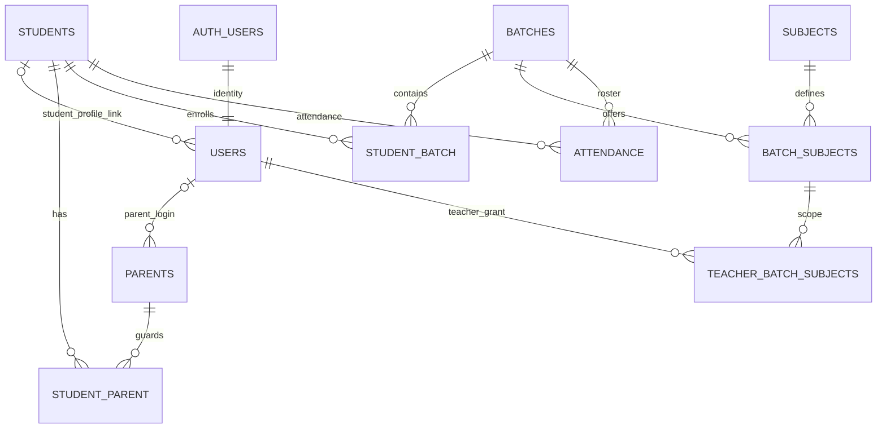
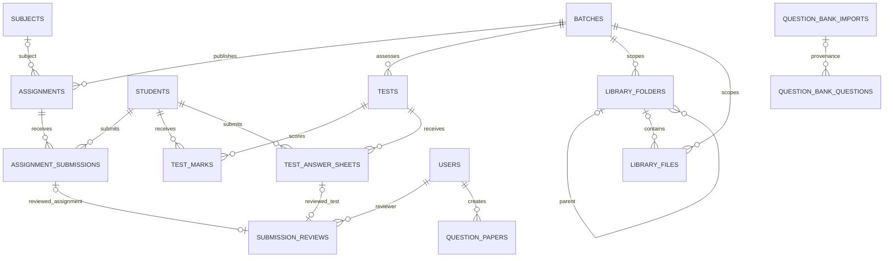
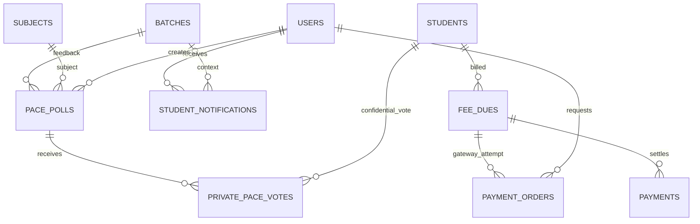
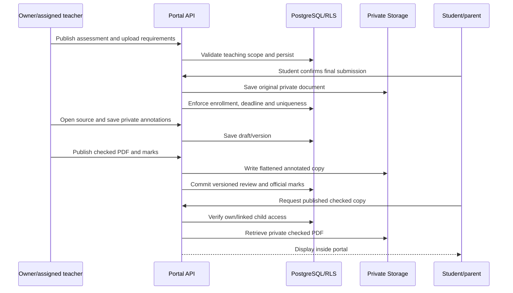
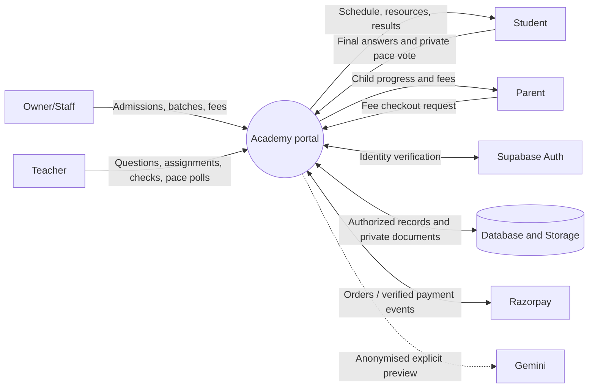

# Amita’s Classes — Complete Project and Report Context

**Snapshot:** 16 November 2026, Asia/Kolkata.  
**Purpose:** A self-contained handover for a new ChatGPT conversation, college capstone analysis report, SRS, Word document, ER diagrams, DFDs, presentation and viva.  
**Suggested academic title:** Design and Development of a Role-Based Tuition Management and Digital Assessment Portal.  
**Academy:** Amita’s Classes. Repository folder: `TutionApp/TutionApp`; npm project: `tuition-app`.

## 1. Instructions for the next AI/report writer

Use this snapshot as the current reference. Distinguish implemented application features, experimental previews, configured external services and future scope. Older project documents contain historical supplements that contradict later changes; this file describes the final intended behavior as of this snapshot.

Do not invent survey findings, real-user counts, measured accuracy, performance benchmarks, financial transactions or production security certification. Do not claim that AI checking is automatic final grading. Do not call the portal a native Android/iOS app. Never include API keys, passwords, connection strings, tokens, student personal data or `.env.local` contents in a report.

This document includes Mermaid diagram source. Render diagrams to images before inserting them in Word. The SQL appendix records migration-defined structure, including additive changes; it is not a fresh hosted-database introspection. Relationships in the diagrams are selected logical/database relationships; the SQL appendix determines exact FK, nullability and deletion behavior.

## 2. Background and problem statement

Tuition academies coordinate admissions, batches, subjects, teachers, attendance, fees, resources, assessments and parent communication. Fragmented paper registers, spreadsheets and messaging channels make records difficult to reconcile and learning feedback difficult to trace. Teachers may need to carry physical answer sheets, students may miss deadlines/resources, and parents may have limited visibility into progress.

The project centralizes academy administration and learning workflows in a web portal with role-based access, a relational database and private document storage. Its distinctive implemented components are in-portal answer-sheet annotation and a confidential Teaching Pace Detector. An isolated Gemini checking preview explores assisted assessment without changing official grades.

The background describes the design motivation; no formal field study is asserted.

## 3. Objectives and scope

- Maintain student contacts, admissions, guardian links and batch enrollment.
- Give teachers access only to explicitly assigned batch/subject scopes.
- Record batch attendance and expose each learner’s own records.
- Generate fee dues, record payments/receipts and provide gateway integration.
- Organize batch resources in folders with private file access.
- Create question banks and branded, section-based examination papers.
- Publish assignments/tests with deadlines and collect final digital submissions.
- Check answer sheets inside the portal and share detailed checked PDFs.
- Provide linked parents read-only academic progress and fee access.
- Persist student batch notifications across logins.
- Collect deadline-controlled private feedback on teaching pace.
- Experiment with AI checking in a separate preview that does not publish marks.

## 4. Architecture and technology

| Layer | Implementation |
|---|---|
| Frontend | Next.js App Router, React 18, TypeScript, CSS/Tailwind utilities, Lucide icons |
| Web/backend routes | Next.js route handlers; no separate Express/Django service |
| Authentication | Supabase Email Auth; password verified by hosted Auth |
| Database | Supabase PostgreSQL with foreign keys, constraints, triggers, RPCs and RLS |
| File storage | Private Supabase Storage buckets |
| Live updates | Supabase Realtime with polling/focus recovery in relevant modules |
| PDF view | Locally served PDF.js canvas renderer with academy loading states |
| Document generation | jsPDF/AutoTable for reports/papers; pdf-lib for checked PDFs |
| Document parsing | Mammoth for DOCX text; XLSX parsing for question-bank spreadsheets |
| Payments | Razorpay order creation and signature-verified captured-payment webhook |
| Experimental AI | Gemini Developer API REST, `gemini-2.5-flash` |
| Deployment | Vercel frontend and Next.js functions; hosted Supabase backend |
| Testing | Node test runner, PGlite SQL checks, disposable-account live acceptance scripts and local Chrome/Playwright tools |

Repository is an npm workspace: `apps/web` and `packages/shared`. The shared package contains common definitions/constants and builds before web production deployment. `package-lock.json` is authoritative. The old pnpm lock/workspace files were archived locally to avoid package-manager detection conflicts. The workspace pins npm in `packageManager`. Keep optional dependencies installed.

### Architecture diagram



## 5. Roles and permissions

| Capability | Owner | Staff | Teacher | Student | Parent |
|---|---|---|---|---|---|
| Academy accounts, roles and teaching assignments | Manage | No | No | No | No |
| Admissions, batch administration and fee operations | Manage | Operational access | Assigned roster only | Own profile read | Linked child read |
| Teaching subject scope | All | Operational permissions | Explicit batch + subject grants | Own enrollment | Child enrollment |
| Attendance | Manage | Manage | Not exposed as a normal teacher attendance module | Own read | Linked child read |
| Library upload/folder/link/delete | Owner only | Read | Assigned batch read | Own batch read | Child batch read |
| Question-bank import/paper builder | Manage | No | Assigned class/subject scope | No private bank access | No private bank access |
| Assignment publishing/checking | Manage | Not teaching manager | Assigned batch/subject only | Own submission/read | Child read-only progress |
| Test creation/marks | Manage | Operational marks module | Assigned subject tests | Own results/submissions | Child results/submissions |
| Answer-sheet annotations and publication | Manage | No | Assigned assessment only | Read own published copy | Read child published copy |
| Teaching pace poll management | Manage | No | Assigned batch/subject | One eligible private vote | No access |
| Pace trends | Scoped aggregates | No | Scoped aggregates | No individual/class vote list | No access |
| AI checking preview | Access | No | Access within assessment scope | No | No |
| Online fee checkout | Access | Access | No | No direct fee checkout tab | Linked child dues |

These are product-facing permissions. Authorization is enforced using authenticated server checks, database RLS and RPC guards; UI hiding alone is not a security boundary. Some legacy operational/offline routes have broader role guards and must not be described as a fully developed teacher attendance product.

## 6. Authentication and account lifecycle

One login identifier accepts either registered email or mobile number, together with a password. Mobile is matched to the academy profile and mapped to its registered email. Supabase Email Auth verifies the password. Phone Auth and SMS OTP are not required. UI displays ten-digit mobile numbers; internal canonical normalization preserves existing records.

Admin-created accounts use temporary password `123456` and must change it on first login. Database guards and middleware prevent normal academy use until the password is changed. Owner bootstrap/password synchronization reads a private local environment value; it is a provisioning operation, not an environment password comparison on every login. Changing the password through Auth remains authoritative until an explicit synchronization is requested.

Owner account editing supports name/email/mobile/status with Auth email synchronization and rollback handling. Teachers must receive initial batch/subject assignments. Owners manage parent-child and student-profile links. Inactive accounts lose access. Recovery is email-only; the hosted email template, SMTP/delivery and production redirect configuration need separate verification.

## 7. Implemented functional modules

### 7.1 Admissions and student directory

Student details include name, class, school/board, dates, address, email and mobile. Guardian relationships and batch enrollment are saved through transactional admission logic. Student login provisioning is distinct from saving admission: a visible retry can create/link the login if account setup fails. A matching retry must not reset an existing password. Directory actions have explicit View profile, Edit student and Mark as left labels. Marking a learner as left is a status workflow, not unrestricted deletion of historical records.

### 7.2 Batches, subjects and teaching scope

Batches contain class, subject list, schedule, fee and active status. Normalized `subjects` and `batch_subjects` coexist with legacy batch subject arrays and synchronization logic. `teacher_batch_subjects` is the explicit authorization scope. Enrollment carries start/end dates and optional custom fee. Parent links support multiple children.

### 7.3 Attendance

Batch roster, date and attendance status support present/absent/late/leave. Atomic RPC marking prevents partial roster updates. Student and parent views are student-scoped and refreshed live. Late counts as attended; leave is excluded from the attendance denominator. Offline attendance queue/synchronization infrastructure exists, but does not mean every module works offline.

### 7.4 Fees, payments and receipts

Monthly fee generation uses enrollment/batch/custom fees and preserves existing dues. Dues support generated amount, paid amount, due date and status. Partial/offline payment and reversal workflows maintain history. PDF receipts and spreadsheet/report exports are available.

Razorpay uses server-calculated remaining dues, creates an order and records its mapping. Checkout success is not a receipt: a valid `payment.captured` webhook settles the recorded order through a service-only RPC. Signature validation, amount validation and idempotent settlement protect the flow. Shared checkout handles load failures/cancellation. Test/Live/unconfigured UI indicators exist. **Actual Razorpay test transaction and live account acceptance were not completed; the user deferred payment setup.** Test payments would update the configured fee database, so dedicated test dues are required.

### 7.5 Batch learning library

Owner uploads PDF/Word documents or HTTPS links and creates nested folders. Selection and new Storage paths are batch-based, avoiding ambiguous class labels like 10 versus 10th. Folder selection controls upload destination. Students see enrolled-batch content; parents see child-batch content; teachers have assigned-batch read access. Owners delete resources and empty folders. Old ambiguous class resources remain owner-only until explicitly reassigned; recovery preserves original storage paths. PDF opens in the portal; DOCX text preview preserves original download but not full Word layout.

### 7.6 Question bank and paper builder

Owner/assigned teacher imports TXT, XLSX, CSV, DOCX or text-based PDF using one uploader. Import preview precedes transactional save; templates and validations aid import. Questions contain class, subject, text, options, marks and optional private answer. Class/subject choices derive from active batches and teacher scope.

Paper builder supports searching questions, selecting marks, named sections, question drag/reorder and mobile fallback controls. Saved papers can be reopened with revision guards. Branded A4 PDFs show the actual examination title, class/subject, date, time, maximum marks, student name/roll lines, numbered instructions and a separator before questions. Private bank answers are excluded from the student paper snapshot. OCR of scanned question PDFs, arbitrary equations and exact source-layout reproduction are not provided.

### 7.7 Assignments and final submissions

Separate Publish assignment and Review assignments tabs. Teacher/owner chooses batch, subject, all or selected enrolled students, question text/document, deadline, maximum marks and answer-upload format. Formats are PDF/DOCX; scanned mode requires one PDF.

Students confirm upload before submission. Cancel sends no upload request. Once submitted, assignment/test answer sheets cannot be replaced, even before checking: API prechecks and database triggers protect originals. Existing grades/review metadata remain editable through permitted teaching workflows. Deadlines are checked server-side.

### 7.8 Tests, results and digital answer-sheet checking

Tests have subject, date, maximum marks, optional requested uploads, format and deadline. Teachers/owners can choose manual marks or digital checking. Student subjects come from enrolled batches; ungraded tests show Awaiting result instead of a fabricated zero score. Published marks and test metadata refresh through Realtime.

PDF checking provides ticks, crosses, mark stamps, comments, freehand pen, undo, annotation deletion and overall marks/feedback. Drafts remain private to the teaching team. Publishing flattens annotations into a checked PDF and appends an academy feedback summary, synchronizes assignment/test scores and exposes the copy to the student/linked parents. Stale source/review guards reject conflicting saves. Published-copy integrity guards reject manual marks inconsistent with the published review; teachers can republish a revised checked PDF.

Originals are unchanged. DOCX is converted from readable text for checking; layout/images are not fully reproduced. Scanned PDFs retain original visual pages without requiring OCR. Typical constraints: 10 MB source uploads, 100 source PDF pages, 1,500 annotations and 25 MB checked PDF storage. These are application limits, not a guarantee that every host accepts that request size.

### 7.9 Notifications

Persistent `student_notifications` records are addressed to actual users. Batch assignments, tests, resources, attendance, result publication, batch changes and notices generate relevant updates. Targeted assignments notify selected learners; individual attendance/results notify the affected learner. Login shows unread badge/toast; bell history has tab links and a stored mark-as-read action. Realtime and fallback refresh receive new events. Other-batch users cannot read/mark another inbox. Library activity and action toasts serve other roles. The older notification queue supports reminder/provider infrastructure, but external delivery is not verified.

### 7.10 Teaching Pace Detector — distinctive implemented feature

Owner/assigned teacher selects batch, subject, completed class topic/date and a deadline within 30 days. Creating a poll enables it; it can be disabled/re-enabled before expiry. Eligible students see it on Overview/Class schedule only while enabled and unexpired. Choices are Too Fast, Perfect and Too Slow, one vote per student/poll. Database locks and keys prevent duplicate/concurrent votes.

Votes are stored in `private.pace_votes`; teachers do not receive names, student IDs or individual choices. Weekly batch/subject aggregates use closed polls and require at least five distinct responding students. Small groups show no trend. Database operators still retain privileged access: describe it as confidential voting, not cryptographic anonymity. This feature was tested for scope, deadline, duplicate vote and small-group suppression; no formal educational-impact study is claimed.

### 7.11 Gemini AI checking — experimental preview only

Standalone owner/teacher page `/owner/ai-checking-preview`; normal assessment navigation/checking is unchanged. Flow: Batch → Test/Assignment → Assessment → Student submission. Only accessible records appear. Changing selection clears previous input/result.

Assignment mode privately reuses saved question text/attached paper and the student submission. Test mode reuses the submitted answer sheet, but generated papers are not linked to tests, so teacher supplies matching questions. No saved assignment answer key exists: teacher provides expected answers/marking guidance and question maximums. Rubric totals must match the saved assessment maximum. Manual checking remains independent.

Uses server-only Gemini API key and `gemini-2.5-flash`, structured JSON output, bounded scores, unique question coverage, recomputed totals, feedback and evidence. PDF/document content is untrusted input. Outputs are plain text suggestions requiring teacher verification. The preview does not write grades, annotations or documents to Supabase or publish to parents/students. Explicit anonymised-sample consent is required before Google transmission. Free-tier availability/quotas and data-use terms depend on Google; unlimited/free access is not promised. Key was absent at verification: TypeScript/mocked API tests passed, but live model accuracy/handwriting evaluation remains unverified. This is not a production automated grading module.

## 8. Database design overview

PostgreSQL stores relational records; file binaries live in Supabase Storage with object paths in database rows. Auth credentials live in managed `auth.users`, not a custom plaintext password table. `public.users.id` links the Auth identity to role/status and optionally a student profile.

### Data dictionary and relationships

| Entity | Purpose and key relations |
|---|---|
| users | Auth-linked academy account, role/status, contacts, optional student FK |
| students | Admission/contact/academic profile |
| parents | Guardian/parent profile, optional linked academy user |
| student_parent | Student ↔ parent relationship bridge |
| batches | Teaching group, class, legacy subjects, fee/schedule/status |
| student_batch | Student ↔ batch membership with dates/custom fee |
| subjects | Unique subject catalog |
| batch_subjects | Batch ↔ normalized subject bridge |
| teacher_batch_subjects | Teacher ↔ batch/subject authorization grants |
| attendance | Student/batch/date status; unique roster record |
| holidays | Holiday date/reason and optional batch |
| fee_plans | Fee configuration and applicable dates |
| fee_dues | Student billing record, amounts/dates/status |
| payments | Receipt/payment/reversal history against learner dues |
| payment_orders | Razorpay order ↔ due/requester mapping |
| materials | Legacy batch learning materials; separate from newer library |
| library_folders | Nested batch folders with parent relationship |
| library_files | Private documents or links, optional folder, batch scope |
| library_activity | Persistent resource activity with batch context |
| tests | Batch/subject assessment and upload settings |
| test_marks | Student/test score and remarks, unique pair |
| attendance_sync_keys | Offline attendance synchronization idempotency |
| assignments | Batch/subject questions, deadline, marks and optional targeted student UUID array |
| assignment_submissions | Unique student/assignment final source document and grade metadata |
| test_answer_sheets | Unique student/test final source document |
| submission_reviews | Draft/published annotations and checked PDF; exactly one assignment-submission OR test-sheet FK |
| question_bank_imports | Source file/import provenance |
| question_bank_questions | Class/subject bank question, marks/options/private answer |
| question_papers | Immutable-at-generation question snapshots, sections and examination metadata |
| notices | Audience-scoped announcements |
| contact_change_requests | Contact change workflow records |
| audit_log | Operational change history |
| notifications | Legacy queued reminders/provider status and dedupe metadata |
| student_notifications | Per-recipient persistent batch inbox/read timestamp |
| pace_polls | Batch/subject class feedback window and deadline |
| private.pace_votes | Confidential student/poll choice; no client table access |
| private.app_schema_versions | Deployment helper migration checksum ledger |

The question-paper `questions` snapshot and annotation arrays use JSONB. Targeted assignment students use an array, not a separate assignment-recipient table. Weekly pace trends are computed aggregates, not a standalone trend table. There is no AI-results table because AI preview does not persist results.

### ER diagram: identity, enrollment and teaching



### ER diagram: assessments and resources



Exactly one of the two review source relationships is populated. Question-paper snapshots logically originate from bank questions; do not invent a relational paper-question bridge or a test-paper foreign key.

### ER diagram: finance and feedback



## 9. Important business constraints, RPCs and Storage

Key invariants: active role check, forced first password change, enrollment dates, assigned subject access, upload signature/size validation, final nonreplaceable source documents, deadline enforcement, bounded marks, optimistic review revision checks, private drafts, checked-copy score consistency, one pace vote per eligible student and idempotent payment settlement.

Important RPCs include `save_student_admission`, `mark_batch_attendance`, `submit_assignment`, `grade_assignment_submission`, `submit_test_answer`, `save_submission_review`, `import_question_bank`, `edit_academy_account`, `assign_new_teacher_scopes`, `set_parent_children`, `settle_gateway_payment`, `read_student_notifications`, `recover_class_library`, `pace_catalog`, `save_pace_poll`, `toggle_pace_poll` and `vote_teaching_pace`. Migration source defines exact signatures. Service-role operations must remain server-only.

| Private bucket | Content |
|---|---|
| assignment-files | Assignment question files and original student assignment submissions |
| learning-library | Batch folder documents and resources |
| question-bank | Original import sources |
| answer-sheets | Original test submissions and flattened checked PDFs |

Application APIs authorize row access before privileged file fetching. Knowing a Storage path is not sufficient authorization. Original and checked paths are distinct; publication exposes only authorized checked copies. Database backups and helper TLS certificates are local administrative assets, not public frontend files.

## 10. Process diagrams / DFD guidance

### Digital checking sequence



### DFD Level 0



For DFD Level 1 split into Authentication, Admission/Enrollment, Attendance, Finance, Resources, Assessment/Checking, Notifications and Pace Feedback. Separate data stores for profiles/enrollments, assessment records, fee records and private documents. Experimental AI must remain a distinct optional external process.

## 11. Main routes and project organization

| Route/group | Purpose |
|---|---|
| `/auth/login`, `/auth/update-password` | Unified login and password changes |
| `/auth/callback`, `/auth/confirm` | Recovery session/token processing |
| `/owner`, `/owner?view=management` | Owner overview and tools |
| `/owner/students`, `/owner/batches`, `/owner/users` | Administration |
| `/owner/attendance`, `/owner/fees`, `/owner/payments` | Operational records |
| `/owner/materials`, `/owner/question-papers`, `/owner/assignments`, `/owner/tests` | Learning/assessment management |
| `/owner/pace` | Owner/teacher pace management |
| `/teacher?view=assignments`, `/teacher?view=papers` | Teaching workspace |
| `/student?view=...`, `/parent?view=...` | Learner/family modules and child selection |
| `/owner/ai-checking-preview` | Isolated AI experiment |
| `/api/assignments`, `/api/answer-sheets`, `/api/checking` | Assessment/private document APIs |
| `/api/library`, `/api/question-bank`, `/api/question-papers` | Resource/import/paper APIs |
| `/api/pace` | Pace catalog, management and voting |
| `/api/ai-checking-preview`, `/api/ai-checking-preview/catalog` | Experimental inference and permitted assessment selector |
| `/api/payments/create-order`, `/api/payments/webhook` | Gateway lifecycle |

`apps/web/src/components` holds portal modules; `src/lib` holds Auth, Supabase clients, validators and document helpers; `src/app/api` holds APIs. `supabase/migrations` holds incremental SQL. `scripts` holds deployment helpers/tests. Public academy images and PDF.js assets live under `apps/web/public`. `.runtime` is ignored local tooling/screenshots/backups, not a deployable source dependency.

## 12. Deployment and current verification status

Vercel deployment URL: `https://amita-classess.vercel.app/`. A supplied Vercel log confirmed successful compilation, 39 generated pages and deployment completion before later preview changes. A subsequent live browser check returned a client exception because public Supabase environment variables were missing. The required hosting variables and redeployment instructions were provided; a successful post-fix live acceptance check is not established by this document. Later local changes require GitHub push/redeployment before they are visible publicly.

Vercel Root Directory: `apps/web`. Install: `cd ../.. && npm ci --include=optional`. Build: `npm run build --workspace=@tuition/shared && npm run build --workspace=@tuition/web`. Output `.next`. `.vercelignore` excludes root migration/helper folders using anchored paths; do not use a broad `supabase` pattern that removes `src/lib/supabase`.

Environment variable names only:
- Required runtime/build: `NEXT_PUBLIC_SUPABASE_URL`, `NEXT_PUBLIC_SUPABASE_ANON_KEY`, server-only `SUPABASE_SERVICE_ROLE_KEY`.
- Optional gateway: `RAZORPAY_KEY_ID`, `RAZORPAY_KEY_SECRET`, `RAZORPAY_WEBHOOK_SECRET`.
- Optional experimental AI: server-only `GEMINI_API_KEY`.
- Optional reminders: `CRON_SECRET`, notification adapter URL/token.
- Local administration: database connection/certificate and owner bootstrap configuration; not needed in frontend bundles.

Public variables are compiled into the browser bundle and require rebuilding when changed. Service role, gateway secrets, AI key and DB credentials must never receive a NEXT_PUBLIC prefix. Hosted Supabase URL/redirect/email settings must match the deployed HTTPS domain.

**Known hosting limitation:** Vercel Functions payload limits conflict with some 10 MB upload/API document responses. A proper large-file direct-upload/download strategy remains needed for full advertised-size support on that host. Do not report all large-document paths as verified on Vercel.

Recorded local/live checks covered password/login role isolation, admissions, billing/reversal, attendance, scoped teacher imports, batch-private storage, checked PDFs, final-submission confirmation, immutable source protection, result publication and pace safeguards. Disposable test identities/documents were cleaned up. Mocked AI tests do not establish model accuracy. No general production penetration test, stress benchmark, genuine student trial or live financial certification is claimed.

A deployment audit recorded two critical and five high production dependency findings in Next.js/PDF and other libraries. Major dependency remediation was not completed. This is a production-readiness limitation despite a successful build. Never claim vulnerability-free production readiness.

## 13. Nonfunctional requirements and limitations

- Security: least privilege, database RLS, authenticated private document routes, signature verification, bounded input and first-password guards.
- Integrity: transactions, FK/unique/check constraints, idempotency, revision checks and original-document preservation.
- Usability: consistent labelled buttons, academy branding, clear loading/errors, responsive portal and in-app PDF rendering.
- Maintainability: typed modules, shared definitions, additive checksum-tracked SQL migrations and reproducible lockfile.
- Privacy: confidential pace aggregates; AI requires explicit anonymised sample transmission. Privileged operators remain trusted.
- No native mobile application, universal offline support, rich Word reconstruction, plagiarism detector, unrestricted scan OCR or production AI auto-grading.
- No promise of unlimited Gemini free tier, activated live Razorpay account or verified external notification/email delivery.

## 14. Future scope and suggested priority

1. Remediate dependency vulnerabilities and finish deployed role/file/auth acceptance checks.
2. Implement authorized large-file direct Storage upload and efficient private download compatible with Vercel limits.
3. Link generated question papers explicitly to tests; persist reviewed answer keys/rubrics and question-level scoring.
4. Evaluate AI preview against teacher-labelled samples before integration; add acceptance/audit/version guards if used for official review.
5. Chapter/topic learning-gap map and targeted practice/retest cycle based on real assessments.
6. Complete Razorpay Test Mode acceptance, hosted recovery delivery and external reminder configuration.
7. More capable Word/scanned-question import, accessibility checks and broader device testing.

## 15. Suggested college Word report structure

1. Title page, certificate/declaration, acknowledgement, abstract and contents.
2. Introduction: academy context, background, problem, objectives and scope.
3. Existing approach and proposed system; avoid fabricated field survey claims.
4. Feasibility: technical, operational and economic assumptions.
5. Requirements: functional modules, nonfunctional requirements and role use cases.
6. System design: architecture, DFD Level 0/1, ER diagrams, data dictionary and security design.
7. Implementation: stack, source organization, key workflows, private Storage and RLS/RPC design.
8. Distinctive features: digital checking and Teaching Pace Detector; AI as an experimental subsection.
9. Testing: scenarios, expected/observed results and limitations; use actual evidence only.
10. Deployment: Vercel/Supabase setup, configuration boundaries and known blockers.
11. Conclusion, limitations, future scope, references and appendices/screenshots.

Suggested abstract: “Amita’s Classes is a role-based web portal that centralizes tuition academy administration and learning activities. The application combines student enrollment, batch and subject management, attendance, fees, private learning resources and assessments using Next.js and Supabase. Teachers can annotate digital answer sheets and publish detailed checked PDFs to students and linked parents. A deadline-controlled Teaching Pace Detector collects confidential student feedback and releases aggregate weekly trends subject to a minimum-response threshold. An isolated AI checking preview investigates assisted evaluation without modifying official grades. The project demonstrates database-backed authorization and integrated academic workflows while retaining explicit limitations around external service activation, deployment security and AI verification.”

## 16. Prompt to paste into a new ChatGPT conversation

> Read this complete Markdown document as my capstone project context. Prepare a formal college project analysis/report in English, suitable for Word. Use Amita’s Classes as the academy name and the suggested academic title. Include background, problem statement, objectives, scope, feasibility, requirements, role permissions, architecture, DFDs, ER diagrams, database dictionary, module descriptions, implementation, testing, deployment, limitations and future scope. Treat SQL in the appendix as cumulative migration definitions; do not invent missing foreign keys. Distinguish implemented modules from Gemini experimental preview and unverified external services. Do not invent survey data, test metrics, production readiness or real payment success. Ask only for college-specific formatting, student/team details and missing report requirements. Generate chapters progressively and supply Mermaid diagram sources plus explanations for Word conversion.

## 17. Database structure appendix

The following appendix is generated from all 22 repository migration files. Read table creation and later ALTER statements cumulatively. It intentionally omits credentials, data rows, Auth internals and full RPC bodies. Full migration files remain the authoritative implementation source for policies/functions/triggers.

Migration files reviewed: **22**. Distinct application/feedback table definitions found: **36** (including private vote storage; managed Supabase Auth/Storage tables are external to this count).

Table inventory: `assignment_submissions`, `assignments`, `attendance`, `attendance_sync_keys`, `audit_log`, `batch_subjects`, `batches`, `contact_change_requests`, `fee_dues`, `fee_plans`, `holidays`, `library_activity`, `library_files`, `library_folders`, `materials`, `notices`, `notifications`, `pace_polls`, `parents`, `payment_orders`, `payments`, `private.pace_votes`, `question_bank_imports`, `question_bank_questions`, `question_papers`, `student_batch`, `student_notifications`, `student_parent`, `students`, `subjects`, `submission_reviews`, `teacher_batch_subjects`, `test_answer_sheets`, `test_marks`, `tests`, `users`.

### 20261031_01_initial_schema.sql

```sql
CREATE TABLE IF NOT EXISTS users (
  id UUID REFERENCES auth.users(id) ON DELETE CASCADE PRIMARY KEY,
  name TEXT NOT NULL,
  phone TEXT UNIQUE NOT NULL,
  email TEXT UNIQUE,
  role TEXT NOT NULL DEFAULT 'parent' CHECK (role IN ('owner', 'staff', 'teacher', 'parent', 'student')),
  status TEXT NOT NULL DEFAULT 'active' CHECK (status IN ('active', 'inactive', 'pending')),
  last_login TIMESTAMP WITH TIME ZONE,
  created_at TIMESTAMP WITH TIME ZONE DEFAULT timezone('utc'::text, now()),
  updated_at TIMESTAMP WITH TIME ZONE DEFAULT timezone('utc'::text, now())
);

CREATE TABLE IF NOT EXISTS students (
  id UUID PRIMARY KEY DEFAULT uuid_generate_v4(),
  name TEXT NOT NULL,
  class TEXT NOT NULL,
  school TEXT,
  board TEXT CHECK (board IN ('CBSE', 'State Board', 'ICSE', 'Other')),
  date_of_birth DATE NOT NULL,
  admission_date DATE NOT NULL,
  address TEXT,
  status TEXT NOT NULL DEFAULT 'active' CHECK (status IN ('active', 'on_hold', 'left')),
  photo_url TEXT,
  created_at TIMESTAMP WITH TIME ZONE DEFAULT timezone('utc'::text, now()),
  updated_at TIMESTAMP WITH TIME ZONE DEFAULT timezone('utc'::text, now())
);

CREATE TABLE IF NOT EXISTS parents (
  id UUID PRIMARY KEY DEFAULT uuid_generate_v4(),
  user_id UUID REFERENCES users(id) ON DELETE CASCADE UNIQUE,
  name TEXT NOT NULL,
  relation TEXT NOT NULL CHECK (relation IN ('father', 'mother', 'guardian', 'other')),
  phone TEXT NOT NULL,
  whatsapp TEXT,
  alternate_phone TEXT,
  email TEXT,
  address TEXT,
  created_at TIMESTAMP WITH TIME ZONE DEFAULT timezone('utc'::text, now()),
  updated_at TIMESTAMP WITH TIME ZONE DEFAULT timezone('utc'::text, now())
);

CREATE TABLE IF NOT EXISTS student_parent (
  student_id UUID REFERENCES students(id) ON DELETE CASCADE,
  parent_id UUID REFERENCES parents(id) ON DELETE CASCADE,
  relation TEXT NOT NULL,
  is_primary BOOLEAN DEFAULT false,
  PRIMARY KEY (student_id, parent_id)
);

CREATE TABLE IF NOT EXISTS batches (
  id UUID PRIMARY KEY DEFAULT uuid_generate_v4(),
  name TEXT NOT NULL,
  class TEXT NOT NULL,
  subjects TEXT[] NOT NULL DEFAULT '{}',
  teacher_id UUID REFERENCES users(id) ON DELETE SET NULL,
  schedule JSONB NOT NULL DEFAULT '{"days": [], "startTime": "00:00", "endTime": "00:00", "timezone": "IST"}',
  base_fee INTEGER NOT NULL,
  is_active BOOLEAN DEFAULT true,
  created_at TIMESTAMP WITH TIME ZONE DEFAULT timezone('utc'::text, now()),
  updated_at TIMESTAMP WITH TIME ZONE DEFAULT timezone('utc'::text, now())
);

CREATE TABLE IF NOT EXISTS student_batch (
  student_id UUID REFERENCES students(id) ON DELETE CASCADE,
  batch_id UUID REFERENCES batches(id) ON DELETE CASCADE,
  start_date DATE NOT NULL,
  end_date DATE,
  custom_fee INTEGER,
  PRIMARY KEY (student_id, batch_id)
);

CREATE TABLE IF NOT EXISTS attendance (
  id UUID PRIMARY KEY DEFAULT uuid_generate_v4(),
  student_id UUID REFERENCES students(id) ON DELETE CASCADE,
  batch_id UUID REFERENCES batches(id) ON DELETE CASCADE,
  date DATE NOT NULL,
  status TEXT NOT NULL DEFAULT 'present' CHECK (status IN ('present', 'absent', 'late', 'leave')),
  marked_by UUID REFERENCES users(id),
  marked_at TIMESTAMP WITH TIME ZONE DEFAULT timezone('utc'::text, now()),
  notes TEXT,
  UNIQUE(student_id, batch_id, date)
);

CREATE TABLE IF NOT EXISTS holidays (
  id UUID PRIMARY KEY DEFAULT uuid_generate_v4(),
  date DATE NOT NULL,
  reason TEXT NOT NULL,
  batch_id UUID REFERENCES batches(id) ON DELETE SET NULL,
  created_at TIMESTAMP WITH TIME ZONE DEFAULT timezone('utc'::text, now())
);

CREATE TABLE IF NOT EXISTS fee_plans (
  id UUID PRIMARY KEY DEFAULT uuid_generate_v4(),
  name TEXT NOT NULL,
  type TEXT NOT NULL CHECK (type IN ('monthly', 'quarterly', 'one_time')),
  amount INTEGER NOT NULL,
  discount INTEGER DEFAULT 0,
  sibling_discount INTEGER DEFAULT 0,
  admission_fee INTEGER DEFAULT 0,
  applicable_to TEXT NOT NULL CHECK (applicable_to IN ('batch', 'student')),
  batch_id UUID REFERENCES batches(id) ON DELETE SET NULL,
  student_id UUID REFERENCES students(id) ON DELETE SET NULL,
  is_active BOOLEAN DEFAULT true,
  created_at TIMESTAMP WITH TIME ZONE DEFAULT timezone('utc'::text, now()),
  updated_at TIMESTAMP WITH TIME ZONE DEFAULT timezone('utc'::text, now())
);

CREATE TABLE IF NOT EXISTS fee_dues (
  id UUID PRIMARY KEY DEFAULT uuid_generate_v4(),
  student_id UUID REFERENCES students(id) ON DELETE CASCADE,
  month TEXT NOT NULL,
  amount INTEGER NOT NULL,
  discount INTEGER DEFAULT 0,
  due_date DATE NOT NULL,
  grace_period_days INTEGER DEFAULT 5,
  status TEXT NOT NULL DEFAULT 'due' CHECK (status IN ('paid', 'partly_paid', 'due', 'overdue')),
  generated_amount INTEGER NOT NULL DEFAULT 0,
  paid_amount INTEGER DEFAULT 0,
  generated_at TIMESTAMP WITH TIME ZONE DEFAULT timezone('utc'::text, now()),
  created_at TIMESTAMP WITH TIME ZONE DEFAULT timezone('utc'::text, now()),
  updated_at TIMESTAMP WITH TIME ZONE DEFAULT timezone('utc'::text, now()),
  UNIQUE(student_id, month)
);

CREATE TABLE IF NOT EXISTS payments (
  id UUID PRIMARY KEY DEFAULT uuid_generate_v4(),
  due_id UUID REFERENCES fee_dues(id) ON DELETE RESTRICT,
  student_id UUID REFERENCES students(id) ON DELETE RESTRICT,
  amount INTEGER NOT NULL,
  mode TEXT NOT NULL DEFAULT 'cash' CHECK (mode IN ('cash', 'upi', 'bank_transfer', 'cheque', 'online')),
  reference TEXT,
  paid_at TIMESTAMP WITH TIME ZONE DEFAULT timezone('utc'::text, now()),
  received_by UUID REFERENCES users(id),
  receipt_no TEXT UNIQUE NOT NULL,
  is_reversal BOOLEAN DEFAULT false,
  reversal_reason TEXT,
  reversal_of UUID REFERENCES payments(id),
  created_at TIMESTAMP WITH TIME ZONE DEFAULT timezone('utc'::text, now())
);

CREATE TABLE IF NOT EXISTS materials (
  id UUID PRIMARY KEY DEFAULT uuid_generate_v4(),
  batch_id UUID REFERENCES batches(id) ON DELETE CASCADE,
  title TEXT NOT NULL,
  subject TEXT NOT NULL,
  topic TEXT,
  file_url TEXT NOT NULL,
  file_type TEXT NOT NULL DEFAULT 'pdf' CHECK (file_type IN ('pdf', 'image', 'document', 'presentation', 'link')),
  file_size INTEGER,
  description TEXT,
  uploaded_by UUID REFERENCES users(id) ON DELETE SET NULL,
  is_hidden BOOLEAN DEFAULT false,
  allow_download BOOLEAN DEFAULT true,
  view_count INTEGER DEFAULT 0,
  created_at TIMESTAMP WITH TIME ZONE DEFAULT timezone('utc'::text, now()),
  updated_at TIMESTAMP WITH TIME ZONE DEFAULT timezone('utc'::text, now())
);

CREATE TABLE IF NOT EXISTS notices (
  id UUID PRIMARY KEY DEFAULT uuid_generate_v4(),
  audience TEXT NOT NULL DEFAULT 'all' CHECK (audience IN ('all', 'class', 'batch')),
  class_id TEXT,
  batch_id UUID REFERENCES batches(id) ON DELETE CASCADE,
  title TEXT NOT NULL,
  body TEXT NOT NULL,
  created_by UUID REFERENCES users(id) ON DELETE SET NULL,
  created_at TIMESTAMP WITH TIME ZONE DEFAULT timezone('utc'::text, now()),
  expires_at TIMESTAMP WITH TIME ZONE
);

CREATE TABLE IF NOT EXISTS contact_change_requests (
  id UUID PRIMARY KEY DEFAULT uuid_generate_v4(),
  parent_id UUID REFERENCES parents(id) ON DELETE CASCADE,
  field TEXT NOT NULL CHECK (field IN ('phone', 'whatsapp', 'email', 'address')),
  old_value TEXT NOT NULL,
  new_value TEXT NOT NULL,
  status TEXT NOT NULL DEFAULT 'pending' CHECK (status IN ('pending', 'approved', 'rejected', 'auto_approved')),
  otp_verified BOOLEAN DEFAULT false,
  approved_by UUID REFERENCES users(id),
  approved_at TIMESTAMP WITH TIME ZONE,
  requested_at TIMESTAMP WITH TIME ZONE DEFAULT timezone('utc'::text, now()),
  created_at TIMESTAMP WITH TIME ZONE DEFAULT timezone('utc'::text, now())
);

CREATE TABLE IF NOT EXISTS audit_log (
  id UUID PRIMARY KEY DEFAULT uuid_generate_v4(),
  user_id UUID REFERENCES users(id) ON DELETE SET NULL,
  action TEXT NOT NULL,
  entity TEXT NOT NULL,
  entity_id UUID NOT NULL,
  old_value JSONB,
  new_value JSONB,
  timestamp TIMESTAMP WITH TIME ZONE DEFAULT timezone('utc'::text, now())
);

CREATE TABLE IF NOT EXISTS notifications (
  id UUID PRIMARY KEY DEFAULT uuid_generate_v4(),
  user_id UUID REFERENCES users(id) ON DELETE CASCADE,
  channel TEXT NOT NULL DEFAULT 'push' CHECK (channel IN ('push', 'whatsapp', 'sms', 'in_app')),
  message TEXT NOT NULL,
  status TEXT NOT NULL DEFAULT 'sent' CHECK (status IN ('sent', 'delivered', 'failed', 'pending')),
  sent_at TIMESTAMP WITH TIME ZONE,
  delivered_at TIMESTAMP WITH TIME ZONE,
  metadata JSONB,
  created_at TIMESTAMP WITH TIME ZONE DEFAULT timezone('utc'::text, now())
);

ALTER TABLE users ENABLE ROW LEVEL SECURITY;

ALTER TABLE students ENABLE ROW LEVEL SECURITY;

ALTER TABLE parents ENABLE ROW LEVEL SECURITY;

ALTER TABLE student_parent ENABLE ROW LEVEL SECURITY;

ALTER TABLE batches ENABLE ROW LEVEL SECURITY;

ALTER TABLE student_batch ENABLE ROW LEVEL SECURITY;

ALTER TABLE attendance ENABLE ROW LEVEL SECURITY;

ALTER TABLE holidays ENABLE ROW LEVEL SECURITY;

ALTER TABLE fee_plans ENABLE ROW LEVEL SECURITY;

ALTER TABLE fee_dues ENABLE ROW LEVEL SECURITY;

ALTER TABLE payments ENABLE ROW LEVEL SECURITY;

ALTER TABLE materials ENABLE ROW LEVEL SECURITY;

ALTER TABLE notices ENABLE ROW LEVEL SECURITY;

ALTER TABLE contact_change_requests ENABLE ROW LEVEL SECURITY;

ALTER TABLE audit_log ENABLE ROW LEVEL SECURITY;

ALTER TABLE notifications ENABLE ROW LEVEL SECURITY;

ALTER TABLE payments ADD CONSTRAINT reversal_integrity CHECK (
  (is_reversal = false AND reversal_of IS NULL AND reversal_reason IS NULL) OR
  (is_reversal = true AND reversal_of IS NOT NULL AND NULLIF(trim(reversal_reason),'') IS NOT NULL)
);
```

### 20261110_02_phase2.sql

```sql
CREATE TABLE IF NOT EXISTS tests (
 id uuid PRIMARY KEY DEFAULT uuid_generate_v4(), batch_id uuid NOT NULL REFERENCES batches(id),
 title text NOT NULL CHECK (length(trim(title))>0), subject text NOT NULL,
 test_date date NOT NULL, max_marks numeric(8,2) NOT NULL CHECK(max_marks>0),
 created_by uuid NOT NULL REFERENCES users(id), created_at timestamptz NOT NULL DEFAULT now()
);

CREATE TABLE IF NOT EXISTS test_marks (
 id uuid PRIMARY KEY DEFAULT uuid_generate_v4(), test_id uuid NOT NULL REFERENCES tests(id) ON DELETE CASCADE,
 student_id uuid NOT NULL REFERENCES students(id), marks numeric(8,2) NOT NULL CHECK(marks>=0),
 remarks text, entered_by uuid NOT NULL REFERENCES users(id), updated_at timestamptz NOT NULL DEFAULT now(),
 UNIQUE(test_id,student_id)
);

CREATE TABLE IF NOT EXISTS attendance_sync_keys (
 id uuid PRIMARY KEY DEFAULT uuid_generate_v4(), client_key uuid NOT NULL,
 user_id uuid NOT NULL REFERENCES users(id), attendance_id uuid NOT NULL REFERENCES attendance(id),
 synced_at timestamptz NOT NULL DEFAULT now(), UNIQUE(user_id,client_key)
);

CREATE TABLE IF NOT EXISTS payment_orders (
 id uuid PRIMARY KEY DEFAULT uuid_generate_v4(), due_id uuid NOT NULL REFERENCES fee_dues(id) ON DELETE RESTRICT,
 student_id uuid NOT NULL REFERENCES students(id), requested_by uuid NOT NULL REFERENCES users(id),
 amount_inr integer NOT NULL CHECK(amount_inr>0), gateway text NOT NULL DEFAULT 'razorpay' CHECK(gateway='razorpay'),
 gateway_order_id text UNIQUE NOT NULL, gateway_payment_id text UNIQUE,
 status text NOT NULL DEFAULT 'created' CHECK(status IN('created','captured','failed')),
 created_at timestamptz NOT NULL DEFAULT now(), captured_at timestamptz,
 UNIQUE(id,due_id)
);

ALTER TABLE tests ENABLE ROW LEVEL SECURITY;

ALTER TABLE test_marks ENABLE ROW LEVEL SECURITY;

ALTER TABLE attendance_sync_keys ENABLE ROW LEVEL SECURITY;

ALTER TABLE payment_orders ENABLE ROW LEVEL SECURITY;

ALTER TABLE notifications ADD COLUMN IF NOT EXISTS template_key text;

ALTER TABLE notifications ADD COLUMN IF NOT EXISTS attempts integer NOT NULL DEFAULT 0;

ALTER TABLE notifications ADD COLUMN IF NOT EXISTS last_error text;

ALTER TABLE notifications ADD COLUMN IF NOT EXISTS scheduled_for timestamptz NOT NULL DEFAULT now();

ALTER TABLE notifications ADD COLUMN IF NOT EXISTS provider_message_id text;

ALTER TABLE notifications DROP CONSTRAINT IF EXISTS notifications_status_check;

ALTER TABLE notifications ADD CONSTRAINT notifications_status_check CHECK(status IN ('pending','processing','sent','delivered','failed'));

ALTER TABLE notifications ADD COLUMN IF NOT EXISTS dedupe_key text;

ALTER TABLE notifications ADD COLUMN IF NOT EXISTS claimed_at timestamptz;
```

### 20261113_04_student_console.sql

```sql
ALTER TABLE public.users ADD COLUMN IF NOT EXISTS student_id uuid REFERENCES public.students(id) ON DELETE SET NULL;

ALTER TABLE public.users ADD CONSTRAINT users_student_link_role CHECK (student_id IS NULL OR role = 'student');
```

### 20261115_06_student_contacts.sql

```sql
ALTER TABLE public.students ADD COLUMN IF NOT EXISTS email text;

ALTER TABLE public.students ADD COLUMN IF NOT EXISTS phone text;
```

### 20261115_07_assignments.sql

```sql
CREATE TABLE IF NOT EXISTS public.assignments (
  id uuid PRIMARY KEY DEFAULT gen_random_uuid(),
  batch_id uuid NOT NULL REFERENCES public.batches(id) ON DELETE RESTRICT,
  title text NOT NULL CHECK(length(trim(title)) BETWEEN 1 AND 160),
  question_text text NOT NULL DEFAULT '' CHECK(length(question_text)<=30000),
  due_at timestamptz NOT NULL,
  max_marks numeric(8,2) NOT NULL CHECK(max_marks>0 AND max_marks<=100000),
  question_path text UNIQUE, question_name text, question_mime text, question_size integer,
  created_by uuid NOT NULL REFERENCES public.users(id) ON DELETE RESTRICT,
  created_at timestamptz NOT NULL DEFAULT now(),
  CHECK(length(trim(question_text))>0 OR question_path IS NOT NULL),
  CHECK(question_path IS NULL OR (question_name IS NOT NULL AND question_mime IN ('application/pdf','application/msword','application/vnd.openxmlformats-officedocument.wordprocessingml.document') AND question_size BETWEEN 1 AND 10485760))
);

CREATE TABLE IF NOT EXISTS public.assignment_submissions (
  id uuid PRIMARY KEY DEFAULT gen_random_uuid(),
  assignment_id uuid NOT NULL REFERENCES public.assignments(id) ON DELETE RESTRICT,
  student_id uuid NOT NULL REFERENCES public.students(id) ON DELETE RESTRICT,
  file_path text NOT NULL UNIQUE, file_name text NOT NULL, file_mime text NOT NULL CHECK(file_mime IN ('application/pdf','application/msword','application/vnd.openxmlformats-officedocument.wordprocessingml.document')),
  file_size integer NOT NULL CHECK(file_size BETWEEN 1 AND 10485760),
  submitted_at timestamptz NOT NULL DEFAULT now(),
  updated_at timestamptz NOT NULL DEFAULT now(),
  marks_awarded numeric(8,2) CHECK(marks_awarded>=0), feedback text NOT NULL DEFAULT '',
  graded_by uuid REFERENCES public.users(id), graded_at timestamptz,
  UNIQUE(assignment_id,student_id)
);

ALTER TABLE public.assignments ENABLE ROW LEVEL SECURITY;

ALTER TABLE public.assignment_submissions ENABLE ROW LEVEL SECURITY;
```

### 20261115_08_attendance_library.sql

```sql
CREATE TABLE public.library_folders (
 id uuid PRIMARY KEY DEFAULT gen_random_uuid(),class_name text NOT NULL CHECK(length(trim(class_name)) BETWEEN 1 AND 40),
 parent_id uuid,name text NOT NULL CHECK(length(trim(name)) BETWEEN 1 AND 120),
 created_by uuid NOT NULL REFERENCES public.users(id) ON DELETE RESTRICT,created_at timestamptz NOT NULL DEFAULT now(),
 UNIQUE(id,class_name),FOREIGN KEY(parent_id,class_name) REFERENCES public.library_folders(id,class_name) ON DELETE RESTRICT,
 CHECK(parent_id IS NULL OR parent_id<>id)
);

CREATE TABLE public.library_files (
 id uuid PRIMARY KEY DEFAULT gen_random_uuid(),class_name text NOT NULL CHECK(length(trim(class_name)) BETWEEN 1 AND 40),
 folder_id uuid,title text NOT NULL CHECK(length(trim(title)) BETWEEN 1 AND 200),
 kind text NOT NULL DEFAULT 'file' CHECK(kind IN ('file','link')),
 storage_path text UNIQUE,file_name text,file_mime text,file_size integer,external_url text,
 created_by uuid NOT NULL REFERENCES public.users(id) ON DELETE RESTRICT,created_at timestamptz NOT NULL DEFAULT now(),
 FOREIGN KEY(folder_id,class_name) REFERENCES public.library_folders(id,class_name) ON DELETE RESTRICT,
 CHECK((kind='file' AND storage_path IS NOT NULL AND file_name IS NOT NULL AND file_mime IS NOT NULL AND file_size IS NOT NULL AND file_mime IN ('application/pdf','application/msword','application/vnd.openxmlformats-officedocument.wordprocessingml.document') AND file_size BETWEEN 1 AND 10485760 AND external_url IS NULL)
 OR (kind='link' AND external_url IS NOT NULL AND external_url ~ '^https://' AND storage_path IS NULL AND file_name IS NULL AND file_mime IS NULL AND file_size IS NULL))
);

ALTER TABLE public.library_folders ENABLE ROW LEVEL SECURITY;

ALTER TABLE public.library_files ENABLE ROW LEVEL SECURITY;
```

### 20261115_09_library_activity.sql

```sql
CREATE TABLE public.library_activity (
 id uuid PRIMARY KEY DEFAULT gen_random_uuid(),
 class_name text NOT NULL,
 actor_id uuid REFERENCES public.users(id) ON DELETE SET NULL,
 action text NOT NULL CHECK(action IN ('created','deleted')),
 resource_kind text NOT NULL CHECK(resource_kind IN ('file','link','folder')),
 title text NOT NULL,created_at timestamptz NOT NULL DEFAULT now()
);

ALTER TABLE public.library_activity ENABLE ROW LEVEL SECURITY;
```

### 20261115_10_question_papers.sql

```sql
CREATE TABLE public.question_bank_imports(id uuid PRIMARY KEY DEFAULT gen_random_uuid(),class_name text NOT NULL CHECK(length(trim(class_name)) BETWEEN 1 AND 40),file_name text NOT NULL,storage_path text UNIQUE NOT NULL,created_by uuid NOT NULL REFERENCES users(id) ON DELETE RESTRICT,created_at timestamptz NOT NULL DEFAULT now());

CREATE TABLE public.question_bank_questions(
 id uuid PRIMARY KEY DEFAULT gen_random_uuid(),import_id uuid REFERENCES question_bank_imports(id) ON DELETE RESTRICT,
 class_name text NOT NULL CHECK(length(trim(class_name)) BETWEEN 1 AND 40),subject text NOT NULL CHECK(length(trim(subject)) BETWEEN 1 AND 100),chapter text NOT NULL DEFAULT '' CHECK(length(chapter)<=150),
 question text NOT NULL CHECK(length(trim(question)) BETWEEN 1 AND 6000),marks numeric(8,2) NOT NULL CHECK(marks>0 AND marks<=1000),
 options jsonb NOT NULL DEFAULT '[]' CHECK(jsonb_typeof(options)='array' AND jsonb_array_length(options)<=6),answer text NOT NULL DEFAULT '' CHECK(length(answer)<=6000),
 created_by uuid NOT NULL REFERENCES users(id) ON DELETE RESTRICT,created_at timestamptz NOT NULL DEFAULT now()
);

CREATE TABLE public.question_papers(
 id uuid PRIMARY KEY DEFAULT gen_random_uuid(),class_name text NOT NULL CHECK(length(trim(class_name)) BETWEEN 1 AND 40),subject text NOT NULL CHECK(length(trim(subject)) BETWEEN 1 AND 100),title text NOT NULL CHECK(length(trim(title)) BETWEEN 1 AND 160),
 exam_date date,duration_minutes integer NOT NULL CHECK(duration_minutes BETWEEN 1 AND 600),instructions text NOT NULL DEFAULT '' CHECK(length(instructions)<=4000),
 questions jsonb NOT NULL CHECK(jsonb_typeof(questions)='array' AND jsonb_array_length(questions) BETWEEN 1 AND 100),total_marks numeric(10,2) NOT NULL CHECK(total_marks>0 AND total_marks<=10000),
 created_by uuid NOT NULL REFERENCES users(id) ON DELETE RESTRICT,created_at timestamptz NOT NULL DEFAULT now(),updated_at timestamptz NOT NULL DEFAULT now()
);

ALTER TABLE question_bank_imports ENABLE ROW LEVEL SECURITY;

ALTER TABLE question_bank_questions ENABLE ROW LEVEL SECURITY;

ALTER TABLE question_papers ENABLE ROW LEVEL SECURITY;
```

### 20261115_11_teacher_parent_roles.sql

```sql
CREATE TABLE public.subjects(id uuid PRIMARY KEY DEFAULT gen_random_uuid(),name text NOT NULL UNIQUE CHECK(length(trim(name)) BETWEEN 1 AND 100),created_at timestamptz NOT NULL DEFAULT now());

CREATE TABLE public.batch_subjects(batch_id uuid REFERENCES batches(id) ON DELETE CASCADE,subject_id uuid REFERENCES subjects(id) ON DELETE RESTRICT,PRIMARY KEY(batch_id,subject_id));

CREATE TABLE public.teacher_batch_subjects(teacher_id uuid REFERENCES users(id) ON DELETE CASCADE,batch_id uuid,subject_id uuid,id uuid NOT NULL DEFAULT gen_random_uuid() UNIQUE,PRIMARY KEY(teacher_id,batch_id,subject_id),FOREIGN KEY(batch_id,subject_id) REFERENCES batch_subjects(batch_id,subject_id) ON DELETE CASCADE);

ALTER TABLE subjects ENABLE ROW LEVEL SECURITY;

ALTER TABLE assignments ADD COLUMN subject_id uuid REFERENCES subjects(id),ADD COLUMN student_ids uuid[];
```

### 20261115_14_teacher_subject_relation.sql

```sql
ALTER TABLE teacher_batch_subjects ADD CONSTRAINT teacher_scope_subject FOREIGN KEY(subject_id) REFERENCES subjects(id) ON DELETE CASCADE;
```

### 20261115_15_batch_library.sql

```sql
ALTER TABLE library_folders ADD COLUMN batch_id uuid REFERENCES batches(id) ON DELETE RESTRICT;

ALTER TABLE library_files ADD COLUMN batch_id uuid REFERENCES batches(id) ON DELETE RESTRICT;

ALTER TABLE library_activity ADD COLUMN batch_id uuid REFERENCES batches(id) ON DELETE SET NULL,ADD COLUMN batch_name text;

ALTER TABLE library_folders DROP CONSTRAINT library_folders_parent_id_class_name_fkey;

ALTER TABLE library_files DROP CONSTRAINT library_files_folder_id_class_name_fkey;

ALTER TABLE library_folders ADD UNIQUE(id,batch_id),ADD CONSTRAINT library_parent_batch FOREIGN KEY(parent_id,batch_id) REFERENCES library_folders(id,batch_id) ON DELETE RESTRICT DEFERRABLE INITIALLY DEFERRED;

ALTER TABLE library_files ADD CONSTRAINT library_file_batch FOREIGN KEY(folder_id,batch_id) REFERENCES library_folders(id,batch_id) ON DELETE RESTRICT DEFERRABLE INITIALLY DEFERRED;
```

### 20261115_17_digital_checking.sql

```sql
CREATE TABLE test_answer_sheets(id uuid PRIMARY KEY DEFAULT gen_random_uuid(),test_id uuid NOT NULL REFERENCES tests(id) ON DELETE RESTRICT,student_id uuid NOT NULL REFERENCES students(id) ON DELETE RESTRICT,file_path text NOT NULL UNIQUE,file_name text NOT NULL,file_mime text NOT NULL CHECK(file_mime IN ('application/pdf','application/vnd.openxmlformats-officedocument.wordprocessingml.document')),file_size integer NOT NULL CHECK(file_size BETWEEN 1 AND 10485760),submitted_at timestamptz NOT NULL DEFAULT now(),updated_at timestamptz NOT NULL DEFAULT now(),UNIQUE(test_id,student_id));

CREATE TABLE submission_reviews(id uuid PRIMARY KEY DEFAULT gen_random_uuid(),assignment_submission_id uuid REFERENCES assignment_submissions(id) ON DELETE CASCADE UNIQUE,test_submission_id uuid REFERENCES test_answer_sheets(id) ON DELETE CASCADE UNIQUE,source_path text NOT NULL,annotations jsonb NOT NULL DEFAULT '[]' CHECK(jsonb_typeof(annotations)='array' AND jsonb_array_length(annotations)<=1500),marks numeric(8,2),feedback text NOT NULL DEFAULT '' CHECK(length(feedback)<=5000),status text NOT NULL DEFAULT 'draft' CHECK(status IN ('draft','published')),reviewed_path text UNIQUE,reviewer_id uuid NOT NULL REFERENCES users(id),updated_at timestamptz NOT NULL DEFAULT now(),CHECK(num_nonnulls(assignment_submission_id,test_submission_id)=1),CHECK(status<>'published' OR (reviewed_path IS NOT NULL AND marks IS NOT NULL)));

ALTER TABLE assignments ADD COLUMN answer_upload_mode text NOT NULL DEFAULT 'document' CHECK(answer_upload_mode IN ('document','scanned_pdf'));

ALTER TABLE tests ADD COLUMN accept_answer_uploads boolean NOT NULL DEFAULT false,ADD COLUMN answer_upload_mode text NOT NULL DEFAULT 'document' CHECK(answer_upload_mode IN ('document','scanned_pdf')),ADD COLUMN answer_due_at timestamptz;

ALTER TABLE test_answer_sheets ENABLE ROW LEVEL SECURITY;
```

### 20261115_20_student_inbox.sql

```sql
CREATE TABLE public.student_notifications(id uuid PRIMARY KEY DEFAULT gen_random_uuid(),user_id uuid NOT NULL REFERENCES users(id) ON DELETE CASCADE,batch_id uuid REFERENCES batches(id) ON DELETE SET NULL,title text NOT NULL,detail text NOT NULL,view text NOT NULL CHECK(view IN ('schedule','materials','assignments','answer-sheets','results','attendance','notices')),created_at timestamptz NOT NULL DEFAULT now(),read_at timestamptz);

ALTER TABLE student_notifications ENABLE ROW LEVEL SECURITY;
```

### 20261115_22_teaching_pace.sql

```sql
CREATE TABLE public.pace_polls(id uuid PRIMARY KEY DEFAULT gen_random_uuid(),batch_id uuid NOT NULL REFERENCES batches(id),subject_id uuid NOT NULL REFERENCES subjects(id),title text NOT NULL CHECK(length(trim(title)) BETWEEN 1 AND 120),class_date date NOT NULL,deadline timestamptz NOT NULL,enabled boolean NOT NULL DEFAULT true,created_by uuid NOT NULL REFERENCES users(id),created_at timestamptz NOT NULL DEFAULT now());

CREATE TABLE private.pace_votes(poll_id uuid REFERENCES public.pace_polls(id) ON DELETE CASCADE,student_id uuid REFERENCES public.students(id) ON DELETE CASCADE,choice text NOT NULL CHECK(choice IN ('fast','perfect','slow')),PRIMARY KEY(poll_id,student_id));

ALTER TABLE public.pace_polls ENABLE ROW LEVEL SECURITY;
```

## 18. Final handover checklist

- This document is the standalone reference for the next chat. No need to paste the complete development conversation.
- Upload this Markdown and, if requested, non-sensitive screenshots to prepare the Word report.
- Diagrams above contain editable Mermaid source.
- Database appendix includes creation definitions and additive column/constraint changes.
- AI and payment readiness limits must remain explicit in the academic report.
