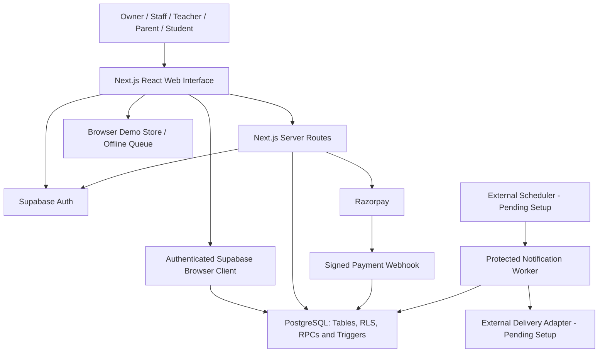
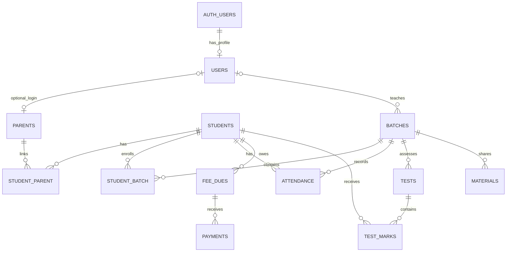

# TuitionApp: Capstone Project Master Context

**Suggested academic title:** Design and Development of a Role-Based Tuition Class Management System  
**Project name:** TuitionApp (local folder spelling: TutionApp)  
**Document date:** 14 November 2026, Asia/Kolkata  
**Purpose:** A standalone factual reference for ChatGPT or a report writer to prepare the college capstone analysis report, synopsis, SRS, design documentation, presentation and viva preparation.  
**Current deliverable:** A web application under development, with implemented core workflows and local validation. It is not yet a fully verified production deployment.

### Latest supplement — 15 November 2026

**Assignments module added and deployed:** owner can publish batch assignments with question text and/or PDF/Word question file, deadline and maximum marks. Enrolled students see deadlines and upload their own PDF/Word submission before closing time. Owner reviews documents in portal, awards bounded marks/feedback; students view results. Ungraded work can be replaced before deadline, graded work cannot. PDF uses an authenticated in-portal iframe; DOCX provides a private text preview plus original download; legacy DOC is download-only. Files are limited to10MB and stored in a private Supabase bucket with per-record/role access, never public links or external Office services.

There are now **seven migration files and22 public application tables**, including assignments and assignment_submissions. Seventh migration/storage setup has been applied to the live project. Local SQL/file tests and live disposable-account upload/view/grade/access-isolation checks passed; test data/files cleaned up. This supersedes older statements that all homework/assignment workflows are missing. Automatic grading, plagiarism detection, assignment notifications and full Word-layout rendering remain outside this implementation. See ASSIGNMENTS.md for source/routes, business rules and verification limits.

**Latest recovery refinement:** the user confirms recovery emails arrive, but their hosted default body contains only a link to the local application. Local recovery template and UI now specify OTP-only recovery with no emailed link/redirect option: request email → enter email recovery code → set new password. The hosted Reset Password template still requires updating through Dashboard or Management API; the access token is not yet supplied. Added a scoped backup/apply/verify script for this setting. Recovery tests now report9 checks and TypeScript passes. Do not claim OTP inbox delivery has been verified until that hosted template is updated and a fresh email is received. Localhost remains expected for a locally running app; no public deployment domain has been supplied.

**Latest real-only change:** demo login, mock identity selection and browser demo-data switching have been removed from the running application. Its data hook always uses real Supabase; old demo sessions are retired on load, while tab-stored historical records are preserved without automatic import. New admission/account workflows no longer offer a demo path. Any earlier description of an available demonstration login now refers only to historical development fixtures, not current application behavior. Real Auth/public profiles and RLS are required for reads/writes. The browser-only Deepak admission in the user's screenshot is not evidence of a persisted Supabase record. New live-only regression checks cover this transition.

**Final authentication design on this date:** the user clarified that Phone Auth/SMS must not be used. Mobile is only an application profile identifier. A unified server endpoint `/api/auth/password` maps mobile to the matching profile's registered email, verifies its password through Supabase Email Auth, checks the identity/active profile and establishes cookies. Email/password uses the same endpoint. Both were live-tested successfully with Phone Auth disabled. New Auth identities are email-only; mobile is stored in application records. The permanent owner has now been provisioned from the user's local configuration and its email/mobile login was verified. Earlier zero-owner/phone-provider-blocker observations below are superseded.

Recovery is email-only: `/api/auth/signin` verifies recovery-email OTPs, and the forgot screen supports email reset links or codes. A real generated recovery code was successfully verified without sending an email or altering the actual owner's password. Normal login still uses a password; this is not mandatory second-factor OTP on every login. A template containing OTP + reset link is in `supabase/templates/recovery.html`, but hosted template deployment, SMTP and actual inbox delivery remain unverified. Do not describe Phone/SMS Auth as required or implemented for the final login design.

**Later live verification on the same date:** the user supplied the required database connection. The complete database upgrade has now been applied over certificate-verified TLS, with application/catalog backups and a compatibility rename of legacy `notices.class` to `class_id`. Contact columns, student-account linkage and tests table are now reachable. Earlier statements below that the hosted schema is incomplete describe the pre-upgrade observation.

Live disposable-account checks passed email/password authentication, first-login data restriction, actual password-change completion, admission/contact retry, monthly fee generation, partial payment/reversal and the running application's student-account provisioning/linkage. Student email login and own-profile isolation also passed. Financial/admission scenario writes were rolled back and all temporary test identities/profiles were cleaned up. Thus there is now hosted Auth/database integration evidence for these specific workflows, not merely local simulation.

Unfinished: actual phone/password login returned `phone_provider_disabled`; no permanent active owner accounts existed after test cleanup, and the intended owner details were requested. Email recovery delivery, SMS, real gateway payment and notification-provider delivery remain unverified. Do not claim the entire system is production-ready or that phone login already works. SQL database access does not automatically configure the hosted Auth email/phone providers. See the latest setup/context notes for these remaining actions.

This supplement supersedes the older snapshot where noted. Student admissions now require separate student email/mobile, stored through a transactional `save_student_admission` RPC. There are **six migrations**, with `20261115_06_student_contacts.sql` following the previous five. It adds `students.email` and `students.phone`, not new tables (the public table count remains 20). Real owners can create and immediately link a student Auth account after saving admission using these contacts. The existing temporary password and forced-change rules apply. Matching retries reuse the existing login without resetting its password. If account creation fails, admission remains saved and a visible retry flow distinguishes that state. Staff saves admissions/contacts but cannot provision accounts; demo does not create real users or send messages.

Latest read-only backend observation: Supabase core tables reachable, tests table still unavailable, Email Auth enabled, **Phone Auth disabled** and local server service-role key missing. SMTP delivery settings were not verified, and no real email/SMS or student provisioning was exercised. A student email in a demo/admission/guardian record alone is not a registered Auth recovery address. Hosted migrations, account provisioning, provider settings and delivery acceptance remain necessary.

The admission layout was also repaired by enabling the missing Tailwind PostCSS plugin, resolving utility-content paths relative to the configuration and adding scoped responsive fields. Served CSS now contains grid/padding utilities. Updated local results include account checks 15, core workflow SQL 16 reported, student SQL 8 and demo 9 passed; TypeScript passed. These still do not constitute live end-to-end validation. See `LOCAL_BACKEND_SETUP.md` for current configuration steps.

## 1. Instructions for the AI/report writer

Read this whole file before generating a report. Use it as the current project reference, including the implementation-status distinctions below. This document consolidates the previous conversation, local source code, migrations, changelogs and recorded verification results. The academic background and suggested report structure are explanatory material, not findings from a conducted field survey.

Follow these rules:

1. Describe implemented features, partially implemented features and future scope separately.
2. Do not claim that every feature has been deployed or tested with real users merely because its source code exists.
3. Do not describe the demo's browser-stored sample records as live database records.
4. The implemented application is a website. Native Android/iOS applications and AI evaluation are future scope.
5. Supabase is the backend, database and authentication service. There is no separately implemented Express, Django, Firebase or MongoDB backend.
6. The current login uses ONE identifier field accepting email OR mobile number, followed by password. There are no separate email/mobile login tabs. SMS OTP code remains in the project but is not the normal real-account login screen.
7. Do not invent surveys, interviews, literature references, performance benchmarks, cost savings, deployment uptime, institution details or dates of work.
8. Use placeholders for student name, enrollment number, college, department, degree, guide, team members and academic year until supplied.
9. If the college provides a chapter format or word limit, adapt the material to it without changing technical facts.
10. Treat security controls as implemented safeguards with stated test boundaries, not proof that the application is invulnerable or legally compliant.

## 2. Project overview and suggested abstract

TuitionApp is a role-based tuition management web application intended to organize the administrative and academic activities of a tuition institute. It brings student admissions, guardian relationships, batch enrollment, attendance, fees, learning resources, tests, results and announcements into a shared system. Different interfaces serve the institute owner, administrative staff, teachers, parents and students.

The application uses Next.js, React and TypeScript for the web interface, Tailwind CSS and custom styles for presentation, and Supabase Auth with a PostgreSQL database for identity and data management. Access is controlled through application checks, server-side authorization and database Row Level Security. Transactional database functions support admissions, monthly fee dues, partial manual payments and reversals. Additional source modules support Razorpay checkout, signed webhooks, notification queues, reports and offline attendance synchronization.

The present implementation includes owner management screens, parent and student learning consoles, administrator-created accounts, password-based login, a first-login password-change workflow, and email password-recovery endpoints. Local production builds and targeted automated tests have passed. Hosted database migration completion, live account provisioning, email delivery, payment-gateway acceptance and complete browser testing remain pending. The project demonstrates the design and incremental implementation of an integrated tuition management system, with mobile applications and AI-assisted academic analysis reserved for future development.

Use this as an abstract draft; shorten or expand it to the required college format.

## 3. Background and motivation

Tuition institutes manage closely related information: a student's admission, guardians, classes, attendance, fee obligations and academic results. These records need to remain consistent while being used by different stakeholders.

A manual or fragmented arrangement may use paper registers for attendance, spreadsheets for fees and separate messaging groups for notices. This can make it difficult to connect a fee payment to the correct monthly due, let a parent review multiple children, or identify who changed an academic record. These are general domain problems motivating this project; no specific institute survey has been documented.

The motivation is to provide one structured application with appropriate access for each role. The owner needs operational visibility, staff need dependable administrative workflows, teachers need class-related tools, parents need information about linked children, and students need access to their own learning information.

**BrightPath Academy** is the demonstration institute name used by the interface. It is not evidence of a real client or deployment partner. Do not use actual children or guardian information in report examples.

## 4. Problem statement

Design and incrementally implement a web-based tuition management system that centralizes administrative and learning records, supports multiple user roles, preserves relationships between students, guardians and batches, maintains traceable fee transactions, and presents relevant information to authorized users.

The system should reduce duplicated record handling and improve the consistency and availability of information. Whether it achieves measurable time savings or accuracy improvements must be evaluated through a future user study; no such quantitative results are currently available.

## 5. Objectives

1. Centralize student, guardian, batch, attendance, fee and learning records.
2. Provide role-specific owner, staff, teacher, parent and student access.
3. Support sibling relationships and student enrollment in multiple batches.
4. Record attendance without confusing attendance status with student lifecycle status.
5. Generate monthly dues and handle partial manual payments, receipts and reversals.
6. Allow parents and students to view the learning information they are permitted to access.
7. Support assessments, marks, remarks, learning resources and targeted notices.
8. Provide exports and operational summaries for the institute.
9. Add account provisioning, password-based authentication and password recovery.
10. Establish foundations for online payments, notification delivery and offline synchronization.
11. Maintain automated checks for selected business and authorization rules.

These are project objectives. Consult the status table before describing any objective as fully achieved.

## 6. Scope and boundaries

### 6.1 Current application scope

The present codebase targets the operations of a tuition institute through a responsive web application. It includes administrative and learning portals and uses a shared backend. The model does not presently establish separate tenant isolation for multiple independent institutes; do not describe it as a verified multi-tenant SaaS platform.

The owner is the highest administrative role. The application uses the term **staff** for administrative personnel below the owner. There is no separate `admin` role value in the database.

### 6.2 Outside the completed scope

- Native Android/iOS applications.
- AI answer-sheet checking, weak-topic detection and predictive insights.
- Complete homework workflows.
- Full offline PWA/service-worker capability.
- Completed private study-file uploads and storage acceptance tests.
- Completed contact-change approval workflows.
- Full import, configurable fee-plan and scheduled billing workflows.
- Fully tested production hosting, backups, monitoring and performance scaling.

## 7. Existing approach versus proposed system

This is a conceptual comparison for analysis, not the result of a measured comparison study.

| Activity | Possible manual/fragmented approach | Proposed TuitionApp approach |
| --- | --- | --- |
| Admissions | Paper forms and separate contact lists | Structured student, guardian and enrollment records |
| Attendance | Daily register and manual counting | Batch/date records, status display and export |
| Fees | Spreadsheet balances and separate receipts | Monthly dues connected to payments and reversals |
| Parent updates | Individual calls or group messages | Linked-child portal and targeted notices |
| Results | Separate score sheets | Tests, marks, remarks and learner result views |
| Resources | Links shared across unrelated chats | Batch-associated resource library |
| Permissions | Shared files or informal access | Authenticated users, role checks and database policies |
| Reporting | Repeated manual consolidation | Data queries, dashboard summaries and exports |

Expected benefits include easier record retrieval, fewer disconnected workflows and clearer responsibility. These benefits should be described as expected until supported by user evaluation.

## 8. Stakeholders and roles

| Role | Main responsibilities or access | Current boundary |
| --- | --- | --- |
| Owner | Academy overview, students, batches, fees, notices, reports, account creation and student-account links | Account creation needs server configuration; full live acceptance pending |
| Staff | Admissions, batches, attendance, manual payments and other permitted administration | Cannot manage owner-only account operations or reverse payments as owner |
| Teacher | Assigned-class assessment/notice/resource tools and offline attendance entry | Dedicated teacher landing page is basic; not a complete teacher console |
| Parent | Select linked child, view schedule, attendance, results, resources, notices and fees | Must have an actual guardian-to-child relationship |
| Student | Own profile and learning schedule, attendance, marks, materials and notices | No academy management or fee console; owner links login to learner profile |

Permissions depend on the particular screen, server route, SQL policy and function. Shared permission constants express intended permissions but do not alone establish that a workflow is available on every screen. For example, report-related constants mention teachers, while the main report page currently defaults to owner/staff access.

## 9. Technology stack and design choices

| Layer/tool | Used technology | Purpose |
| --- | --- | --- |
| Web framework | Next.js 14, App Router | Routing, React pages and server API routes |
| UI | React 18, TypeScript | Interactive components and typed code |
| Styling | Tailwind CSS and custom CSS | Responsive forms, navigation and dashboards |
| Database | PostgreSQL through Supabase | Relational data, constraints, transactions, triggers and RLS |
| Authentication | Supabase Auth | Email/phone password sessions and recovery |
| Server/browser clients | Supabase JS and SSR packages | Authenticated API/database interaction and cookies |
| Charts | Recharts | Dashboard visualization |
| Icons | Lucide React | Interface icons |
| Exports | XLSX, jsPDF, jsPDF-AutoTable | Excel reports and PDF reports/receipts |
| Payment integration | Razorpay HTTP APIs and checkout | Order creation and captured-payment settlement |
| Validation utilities | Zod, React Hook Form and custom validation code | Dependencies available; validation usage varies by module |
| Test tooling | Node test runner, assertions, PGlite, TypeScript compiler | Script tests, local SQL scenarios and type checks |
| Workspace | npm workspaces | Web app plus shared types/constants package |

The package files declare version ranges; they are not exact installed-version guarantees. The local build output recorded Next.js 14.2.35. Node.js 24.11.1 and npm 11.6.2 were available during recorded checks. The root project declares Node.js 20 or newer.

These choices permit one shared web codebase and database authorization model. They do not prove a particular scale, availability level or development cost.

## 10. Architecture

### 10.1 Logical layers

1. **Presentation:** login, owner operational pages, learner consoles, forms, charts and exports.
2. **Application:** role checks, account validation, report assembly, notification orchestration and checkout logic.
3. **Server endpoints:** administrator account creation, authentication callbacks, payment order creation, webhook processing and protected jobs.
4. **Data/business rules:** PostgreSQL tables, constraints, RLS, transactional functions, payment/audit triggers.
5. **External services:** Supabase Auth, Razorpay and optional notification delivery adapter.

Many normal data reads/writes use the browser Supabase client directly and rely on database RLS. Sensitive operations use server routes or database functions. Do not draw every query as passing through a custom Node API server.



Browser demo storage and offline attendance storage serve different purposes: demo data uses session storage, while the offline attendance queue uses local storage. Neither is a substitute for the production database.

### 10.2 Data-flow model for a report

At context-diagram level, TuitionApp exchanges account credentials, administrative records, attendance, payments, learning information and reports with its user roles. External boundaries are Supabase Auth, the payment gateway and notification services.

For a Level-1 DFD, use these processes:

- P1: Authenticate user and manage account access.
- P2: Maintain students, guardians and enrollments.
- P3: Manage batches and attendance.
- P4: Generate dues and record/settle payments.
- P5: Manage assessments, resources and announcements.
- P6: Produce summaries, exports and notifications.

Suggested data stores: identity/profile data; student/guardian/enrollment data; attendance; fees/payments; learning data; notices/notification/audit data. External gateway confirmation enters P4 through the verified webhook, not through a browser success claim.

## 11. Functional requirements and implementation status

**Status meanings:** “Implemented” means source exists. “Locally tested” means relevant checks were recorded. Neither means fully deployed or accepted by real users.

| ID | Requirement | Current status |
| --- | --- | --- |
| FR-01 | Login using email or mobile and password in one form | Implemented; type/build checks passed; live login acceptance pending |
| FR-02 | Require active profile and resolve role from database | Implemented; authorization tests cover selected cases |
| FR-03 | Owner creates users with mandatory email/mobile/name/role | Implemented server endpoint and form; live provisioning pending |
| FR-04 | Set temporary password 123456 and require first-login change | Implemented with app metadata, middleware and SQL; local tests passed |
| FR-05 | Email password reset and new-password page | Implemented; email delivery/configuration pending |
| FR-06 | Create/edit student admission and guardian details | Implemented; isolated SQL transaction tests passed |
| FR-07 | Reuse guardian for siblings and link parent account | Implemented; isolated SQL and demo scenarios passed |
| FR-08 | Enroll student in multiple batches | Implemented; enrollment history and stale-edit checks tested locally |
| FR-09 | Create/edit/deactivate batches and save schedule | Implemented; full browser acceptance pending |
| FR-10 | Mark attendance by batch/date and export records | Implemented; date/roster/save-feedback fixes added |
| FR-11 | Queue attendance offline and synchronize safely | Implemented interim queue/RPC; full offline-device testing pending |
| FR-12 | Generate monthly dues without overwriting paid balances | Implemented and tested in isolated SQL |
| FR-13 | Record partial manual payments and PDF receipts | Implemented; local financial scenarios passed |
| FR-14 | Preserve payments and correct through owner reversals | Implemented; selected immutability/retry/reversal tests passed |
| FR-15 | Online payment through Razorpay | Source implemented; live gateway testing pending |
| FR-16 | Create tests, enter marks and teacher remarks | Implemented; live target tests table previously missing |
| FR-17 | Parent/student learning consoles | Implemented; navigation/demo/SQL isolation tests passed |
| FR-18 | Share batch learning resource links | Implemented; private file upload workflow remains pending |
| FR-19 | Publish notices to all/class/batch | Implemented; audience filtering checks passed |
| FR-20 | Fee, attendance, collection, batch and test exports | Implemented; report correctness review remains |
| FR-21 | Generate reminders and process notification queue | Implemented source; provider and scheduler setup pending |
| FR-22 | Import students from CSV/Excel | Not completed; existing Excel export is not import |
| FR-23 | Configure fee plans and scheduled automatic billing | Schema/core building blocks exist; complete workflow pending |
| FR-24 | Contact-change approval and holiday management | Schema exists; complete workflows pending |
| FR-25 | Full role/status management for existing accounts | Partial; directory, provisioning and student links exist |

## 12. Principal workflows and use cases

### UC-01: Create an account

**Actor:** Active owner who has completed the first-login password change.  
**Input:** Name, email, mobile and role.  
**Flow:** The form calls the owner-only server endpoint. The endpoint verifies the caller through Supabase Auth and the active owner profile. It validates contacts and creates a confirmed Auth identity with temporary password `123456` and server-owned `must_change_password=true`. It then inserts the application profile. If profile creation fails, it attempts to delete only the new Auth identity.  
**Output:** Created account in the directory or a visible error.  
**Boundary:** Service-role configuration and deployed migrations are required. Confirmation here means the administrator supplied trusted contact details; no welcome email is automatically sent by this workflow.

### UC-02: Login and first-password change

**Actors:** Any provisioned role.  
**Input:** Email OR mobile in one field, plus password.  
**Flow:** Detect identifier format, normalize email or mobile, verify password with Supabase Auth, read active application profile and use its role. A new temporary-password user is directed to `/auth/update-password`. Middleware and SQL restrict academy access until the password hash actually changes.  
**Rules:** Ten-digit Indian mobile numbers become `+91` numbers. User-selected passwords require at least eight characters and matching confirmation. Existing accounts are not silently reset to `123456`.

### UC-03: Recover a forgotten password

The user selects “Forgot password?”, supplies the registered email and requests a reset. Supabase sends the recovery email if configured. A callback exchanges the recovery code, or a token-hash confirmation endpoint verifies a recovery token. The user sets a new password in an authenticated recovery session. Expired/invalid links show an error. The success message does not reveal whether an email is registered.

### UC-04: Admit or edit a student

The owner/staff enters student details, selects an existing guardian or supplies guardian information, optionally links an existing parent login, and selects batches. `save_student_profile` performs the connected writes transactionally. Stable IDs help retries, and an expected update timestamp detects stale edits. Removing enrollment ends the row rather than simply discarding its relationship history.

### UC-05: Record attendance

The owner/staff chooses an active batch and date. The screen loads enrollment/attendance records, filters the roster by enrollment dates, and displays unmarked learners as “Not marked.” Selecting a status saves the record, reloads marks and displays feedback. Errors remain visible. “Reload saved marks” refreshes persisted values. Current online attendance still needs complete schedule/holiday rule review; the offline sync function has its own server validations.

### UC-06: Generate and collect fees

Monthly generation calls `generate_student_due`. It calculates enrolled batch/custom fees and preserves an existing due when retried. Owner/staff opens a due and records a partial or full manual payment through `record_manual_payment`, with a stable request ID and locked due. A receipt can be exported. Owner corrections call `reverse_manual_payment`, preserving the original transaction.

### UC-07: Online fee payment

The authorized payer starts checkout for a visible outstanding due. The server authenticates the payer, reads the due under RLS, creates a Razorpay order and records it. The gateway sends a captured-payment webhook. The server validates the signature over the raw payload, checks payment fields and calls the service-role-only settlement function. Browser checkout success alone does not record a payment.

### UC-08: View family/individual learning records

A parent selects a linked child, then views schedule, attendance, results, resources, notices or fees. Siblings are discovered through guardian relationships. A student login uses an owner-managed `users.student_id` link to access its own learning records. Student access is not derived from editable user metadata and does not include the fee console.

### UC-09: Assessments, notices and resources

An authorized owner/staff/teacher creates an assessment and records permitted marks/remarks. Learners view their results. Notices are scoped to everyone, a class or a batch, with expiry handling. Owners and assigned teachers can share HTTPS learning links. File download visibility is a UI option, not digital-rights protection against copying a public external resource.

## 13. Database design

### 13.1 Main relationships

- `auth.users` holds Auth identities; `public.users` extends them with institute profile/role/status.
- A guardian profile can optionally be linked to a user account.
- `student_parent` connects students and guardians and supports siblings/multiple guardians.
- `student_batch` connects students and batches and stores enrollment dates/custom fee.
- Each attendance entry connects one student, batch and date.
- Fee dues belong to students; payments belong to dues and students.
- Tests belong to batches; test marks connect tests and students.
- Materials and some notices belong to batches.
- Student login accounts optionally reference one student profile through `users.student_id`.



This is a simplified conceptual ER diagram. SQL is authoritative for nullability, delete actions, checks and the relationships omitted for readability. Do not claim all foreign keys are mandatory from the conceptual lines above.

### 13.2 Data dictionary summary

The migration files define **20 public application tables**, plus the externally managed Auth schema. The table list describes source schema, not confirmed deployment of every table.

| Table | Important attributes | Purpose |
| --- | --- | --- |
| users | id, name, phone, email, role, status, student_id | Application identity/profile and optional learner link |
| students | id, name, class, school, board, birth/admission dates, address, status | Student academic/admission profile |
| parents | id, optional user_id, name, relation, phone, WhatsApp, email, address | Guardian details independent of login |
| student_parent | student_id, parent_id, relation, is_primary | Student/guardian junction |
| batches | id, name, class, subjects, teacher_id, schedule JSONB, base_fee, is_active | Teaching group and schedule |
| student_batch | student_id, batch_id, start_date, end_date, custom_fee | Enrollment relationship |
| attendance | id, student_id, batch_id, date, status, marked_by, marked_at | Daily batch attendance |
| holidays | id, date, reason, optional batch_id | Holiday data; full management UI pending |
| fee_plans | id, name, type, amount, discounts, applicability | Planned configurable fee definitions |
| fee_dues | id, student_id, month, amount, generated_amount, paid_amount, due_date, status | Monthly obligations and balances |
| payments | id, due_id, student_id, amount, mode, reference, receipt_no, reversal fields | Financial transaction records |
| materials | id, batch_id, title, subject, topic, file_url, type, hidden/download flags | Learning resource metadata |
| notices | id, audience, class_id/batch_id, title, body, expiry | Announcements |
| contact_change_requests | id, parent_id, field, old/new values, status, approver | Proposed contact approval workflow |
| audit_log | id, user_id, action, entity, entity_id, old/new JSONB, timestamp | Change traceability |
| notifications | id, user_id, channel, message, status, metadata and queue/retry fields | Messages and delivery processing |
| tests | id, batch_id, title, subject, test_date, max_marks, created_by | Assessments |
| test_marks | id, test_id, student_id, marks, remarks, entered_by | Learner scores |
| attendance_sync_keys | id, client_key, user_id, attendance_id, synced_at | Offline synchronization deduplication |
| payment_orders | id, due_id, student_id, requested_by, gateway IDs, amount, status | Online checkout order tracking |

The application profile does not store plaintext passwords. Supabase Auth handles password verification and its password hash. Temporary-password state is in server-owned Auth app metadata; the latest migration reacts to Auth hash changes.

### 13.3 Schema evolution

Apply migrations sequentially after inspecting the target migration history:

1. `20261031_01_initial_schema.sql`: initial entities, RLS/helpers and audit/payment safeguards.
2. `20261110_02_phase2.sql`: tests/marks, offline sync, gateway settlement and notification jobs.
3. `20261111_03_core_workflows.sql`: transactional admissions, monthly dues, manual payments/reversals and removal of older permissive user policies.
4. `20261113_04_student_console.sql`: student-account linkage and read-access policies.
5. `20261113_05_account_passwords.sql`: password-change restrictions, Auth hash-change trigger and email requirement for new profiles.

Do not judge the final permissions from the first migration alone: later migrations correct earlier policies. Do not blindly rerun the initial schema on an existing database; policy creation and other statements are not a universal idempotent upgrade strategy.

## 14. Business rules and calculations

- **User status:** active, inactive or pending. Active profile is required for normal login access.
- **Student lifecycle:** active, on_hold or left; distinct from attendance status.
- **Attendance status:** present, absent, late or leave.
- **Learner attendance percentage:** `(present + late) / (present + late + absent) * 100`, rounded in the learner helper. Leave is excluded; zero counted records yields 0. This calculates from stored records, not a verified count of every scheduled class.
- **Fee amounts:** whole INR in the current core workflows. Gateway requests use paise by multiplying by 100.
- **Monthly due:** one aggregate due per student per month. It is not a separate invoice for every batch.
- **Billing contribution:** batch base fee or custom enrollment fee; overlapping enrollment contributes the full monthly fee under current rules.
- **Due generation:** preserve an already generated amount and paid balance on retry, including recognized legacy month formats.
- **Due date:** new monthly dues use the 10th with a five-day grace period.
- **Pending amount:** generated amount minus paid amount, clamped at zero for learner display.
- **Payment status:** paid, partly_paid, due or overdue.
- **Payment methods:** cash, UPI, bank transfer, cheque and online.
- **Corrections:** preserve financial records and use reversals; ordinary staff cannot perform owner-only reversals.
- **Marks:** nonnegative and not above the assessment maximum; enrollment/role checks also apply.
- **Notices:** all, class or batch audience; expired notices are filtered from relevant learner views.
- **Password provisioning:** new admin-created identities use `123456`; new personal password requires 8+ characters. The hosted Auth policy must permit the requested six-character temporary password.

Do not assume that the fee-plan table's quarterly, one-time, sibling-discount and other fields are all used by the completed billing UI. Current generation primarily uses enrolled batch/custom fees.

## 15. Security and access-control design

The project uses several layers: authenticated Auth sessions, active profile checks, role-specific navigation, server authorization, database RLS, transactional functions, immutable payment safeguards and audit records.

Important implemented controls include:

- Only an active owner who has completed the initial password change may create users through the server endpoint.
- Service-role credentials are server-only and must not use a `NEXT_PUBLIC_` variable.
- Account creation checks request origin and ignores client attempts to override the fixed temporary password/flag.
- Parent access is tied to guardian/student relationships.
- Student access is tied to owner-managed profile linkage.
- Teacher actions are restricted by assigned batch policies/functions where implemented.
- The first-login flag is not trusted from client-editable user metadata.
- Database restrictions prevent learning-record access while the password-change requirement remains active.
- The password-change trigger clears the flag only when the stored Auth password hash changes.
- Payment webhook signatures are verified before settlement; financial settlement is service-role restricted.
- Offline sync uses user/client keys to avoid duplicate submissions and rechecks actor permissions.
- Sensitive operations have audit/financial preservation mechanisms.

Known limitations: no independent penetration test, no full concurrency/load test, no verified production backup strategy and no complete browser privacy acceptance. The requested shared temporary password is a capstone provisioning decision, not an example of an ideal long-term production onboarding mechanism. Future work can replace it with individual temporary secrets or invitation links.

## 16. Interface design

The existing interface uses an ivory/forest-green/coral theme, sidebar navigation, operational forms, cards, charts and learner views. Parent/student consoles offer schedule, attendance, results, library and notice sections; parent also includes fees. Responsive CSS includes desktop/mobile breakpoints, but comprehensive device and accessibility testing is not complete.

Recent improvements include readable primary/secondary action colours, visible attendance feedback and a “Not marked” state. A reported unstyled UI was traced to missing CSS/JavaScript assets after a production build overwrote dev output. Development output now uses `.next-dev`, production uses `.next`, and linked assets returned HTTP 200 after restarting. This was a runtime asset repair, not a redesign.

Suitable report screenshots, to capture from actual running pages:

1. Unified email/mobile login.
2. First-login password page and forgot-password request.
3. Owner overview and management navigation.
4. User creation with required email.
5. Student admission/guardian/batch form.
6. Batch schedule management.
7. Attendance marking and visible feedback.
8. Fee due, partial collection and receipt.
9. Parent child-selection/learning views.
10. Student learning console, tests, resources, notices and exports.

Label demo screenshots as demo. A checkout screenshot is not evidence of a completed payment.

## 17. Source structure and important routes

```text
TutionApp/
  apps/web/
    src/app/                 Pages, API routes, auth routes and CSS
    src/components/          App shell, forms and learner consoles
    src/lib/                 Auth, Supabase clients, demo, payment and helpers
    src/middleware.ts        First-login route/API restrictions
    public/                  Demo resources and interface artwork
    next.config.js           Separate dev/production output directories
  packages/shared/src/
    constants/               Role/status/permission definitions
    types/                   Shared TypeScript types
  supabase/migrations/       Five ordered SQL migrations
  scripts/                  Local checks, SQL tests and account bootstrap
  package.json              Workspace commands
```

Main pages: `/`, `/auth/login`, `/dashboard`, `/owner`, `/owner?view=management`, `/teacher`, `/parent`, `/student` and `/owner/{students,batches,attendance,fees,materials,tests,notices,reports,notifications,offline-attendance,payments,users}`. Admission, student, batch and fee detail routes also exist.

| Endpoint | Responsibility |
| --- | --- |
| POST `/api/admin/users` | Authorized owner account provisioning |
| POST `/api/auth/signin` | Retained legacy OTP verification endpoint |
| GET `/auth/callback` | Recovery PKCE code/session exchange |
| GET `/auth/confirm` | Recovery token-hash verification |
| `/auth/update-password` | New-password form |
| POST `/api/payments/create-order` | Authorized Razorpay order creation |
| POST `/api/payments/webhook` | Signature-verified payment capture processing |
| POST `/api/jobs/notifications` | Secret-protected notification worker |

Important implementation references: `auth-context.ts`, `account-validation.ts`, `demo-auth.ts`, `demo-data.ts`, `StudentEditor.tsx`, `LearnerPortal.tsx`, `components/console`, `learner-console.ts`, `payment-checkout.ts` and `lib/phase2` under `apps/web/src`.

## 18. Development approach and work completed

The recorded approach is iterative repair and extension of an existing demo, not a full rewrite. This can be described as incremental development. Do not invent formal sprint durations, team roles, methodology ceremonies or version-control history.

1. **Initial review:** identified foundation problems in imports, React usage, OTP handling, RLS, attendance and fees.
2. **Foundation repair (historical Phase 0):** corrected source structure/auth/client/policy issues while preserving the project.
3. **Extended modules (historical Phase 2):** added online-payment, notification, tests, reports, notices and offline-sync source.
4. **Core workflows (Phase 3):** transactional admissions, guardian links, enrollment, fee generation, manual collection and reversals.
5. **Interface/console work:** refreshed shared UI, owner overview, parent/student consoles, learning resources and student profile linkage.
6. **Real-account work:** distinguished demo from database-backed login, added owner account provisioning, unified email/mobile login, password change and recovery.
7. **Validation and runtime repair:** local builds, targeted tests, backend reachability checks and separation of development/production assets.

Phase names are historical labels, not evidence that everything in a phase is complete.

## 19. Testing and recorded results

These results were recorded during development on 13 November 2026 and the subsequent UI repair. This documentation pass on 14 November does not claim a new test run or fresh backend deployment.

| Verification | Recorded result | Interpretation |
| --- | --- | --- |
| `npm run build:web` | Passed, including type/lint checks and route generation | Source builds; does not prove live providers work |
| TypeScript `tsc --noEmit` | Passed | Semantic type validation |
| `node scripts/phase2-test.mjs` | 15 passed | Mixed parser/helper/static feature checks |
| `npm run test:demo` | 9 passed | Simulated role/data workflows |
| `npm run test:console` | 7 passed | Console helper/render/navigation checks |
| `npm run test:phase3` | 15 reported: 14 scenarios plus enclosing test | Actual SQL admissions/fees/roles in isolated PGlite |
| `npm run test:student-console` | 8 reported: 7 scenarios plus enclosing test | Actual SQL student isolation/linking scenarios |
| `npm run test:accounts` | 13 reported | API mocks, identifier validation and actual SQL password restrictions |
| Production HTTP smoke on port 3001 | Login/password pages 200; invalid recovery links redirected; anonymous create-user 401 | Basic routing/authorization response checks |
| Development UI asset check on port 3000 | Login and linked CSS/JS 200 after repair | Confirms asset availability, not visual usability |
| Historical Phase 0 smoke | Failed on local `.env.local` existence assertion | Archive-packaging assumption; not evidence of a database failure |

Do not add enclosing test counts to scenario counts as if they were independent user workflows. Do not claim code coverage percentages or complete end-to-end automation from these counts.

PGlite tests emulate Supabase auth roles, `auth.uid()` and required Auth columns/functions, and substitute UUID-extension setup. They execute migrations and SQL behavior, but use a single local engine. They do not reproduce hosted Auth email delivery, network behavior, multiple concurrent database connections, hosted storage or all platform grants. Recent existing SQL suites include all five migrations.

Selected tested scenarios include transaction rollback, retry/idempotency, siblings, stale writes, partial collections, overpayment protection, reversals, owner/staff separation, parent/student isolation, inactive access, ended enrollment, account-link permissions, required email, unauthorized provisioning and password-gate bypass attempts.

Tests still needed: actual account creation/login/recovery, browser forms with reload persistence, cross-user URL attempts against hosted Supabase, gateway retry/refund scenarios, provider failures, scheduling rules, physical-device offline sync, accessibility, visual responsiveness, load and concurrent payments.

## 20. Live backend and demonstration status

The local application contains Supabase configuration. A recorded read-only probe reached `users`, `students`, `batches`, `attendance` and `fee_dues`. The `tests` table returned HTTP 404/PGRST205. Therefore, the last observed hosted database was incomplete relative to source migrations. There is no later verification showing this resolved.

The server service-role key was not configured at the last recorded setup check. No live account provisioning, schema migration or authenticated write acceptance was performed by the assistant. Required keys must be supplied locally, not included in this report or pasted into shared chats.

Demonstration mode is development-only, uses sample users/records and is explicitly separate from real authentication. Its sample phone is `123456789` and OTP is `1234`; those are demo credentials, not Supabase passwords. Real newly created accounts use the administrator provisioning flow and temporary `123456`.

**Important terminology:** the application supports interactive database-backed operations in source. A complete live workflow is not established by anonymous reachability checks. No universal Supabase Realtime subscription/live cross-browser update system has been verified; do not describe every screen as automatically synchronized across connected users.

## 21. Non-functional requirements and feasibility

| Concern | Current design/position | Evaluation boundary |
| --- | --- | --- |
| Usability | Role navigation, clear forms, feedback, learner tabs | No completed user study |
| Responsiveness | CSS breakpoints and mobile navigation | Full device testing pending |
| Security/privacy | Auth, RLS, server checks, account/password gates | No penetration/compliance certification |
| Integrity | FK/check/unique constraints, transactions, locking, reversals | Multi-connection concurrency testing pending |
| Maintainability | Shared package and reusable components | Continued refactoring/documentation needed |
| Performance | Indexes and scoped queries exist | No measured response-time/load guarantee |
| Availability/recovery | Hosted deployment/backups contemplated | Uptime and restore verification absent |
| Accessibility | Some labels, alerts, focus and reduced-motion styles | No accessibility audit |
| Localization | English interface | Hindi localization future scope |

Historical aspirations such as three-second loads, 1,000–5,000 students or 99% availability are targets, not measured achievements.

**Technical feasibility:** supported by an existing buildable implementation and local SQL tests, subject to completing live setup.  
**Operational feasibility:** the roles and workflows match the intended domain, but should be evaluated with institute staff/teachers/parents.  
**Economic feasibility:** reuse of one web application and managed backend may reduce development effort, but no validated budget, hosting invoice or ROI calculation exists. Do not invent prices.  
**Schedule feasibility:** no agreed final delivery schedule or original Gantt chart was supplied; produce a proposed schedule only when requested and label it accordingly.

## 22. Known limitations and future work

Current technical follow-up includes incomplete hosted migrations, actual owner provisioning, reset-email setup, gateway/provider integration tests and full form acceptance. Report accuracy also needs review: batch strength currently counts enrollment rows without a complete active-date filter, legacy month representation needs consistent treatment across reporting, and reversal representation should be checked across financial exports. Test rosters need historical/current enrollment review. Online and offline attendance do not yet share a fully validated schedule/holiday rule set.

Planned extensions:

1. Complete live backend setup and acceptance for each role.
2. Finish user role/status updates and existing-account email maintenance.
3. Complete configurable fee plans and reliable scheduled billing/reminders.
4. Implement validated CSV/Excel import.
5. Add private file storage/upload and access tests.
6. Complete contact approval and holiday workflows.
7. Add complete teacher portal and homework management.
8. Harden full PWA/offline roster/background synchronization.
9. Complete gateway refunds and provider delivery observability.
10. Add deployment monitoring, backups, restoration and load tests.
11. Add Hindi localization and accessibility improvements.
12. Develop mobile applications using the shared backend.
13. Explore AI-based answer checking and performance insights after defining data quality, evaluation, privacy and human-review requirements.

## 23. Running and configuring the project

From the root workspace:

```sh
npm install
npm run dev:web
npm run build:web
npm run test:accounts
npm run test:phase3
npm run test:student-console
npm run test:demo
npm run test:console
node scripts/phase2-test.mjs
```

Normal development address: `http://localhost:3000`. Production preview was tested on port 3001; that is not a hosted public deployment. Do not assume either process is still running on a later date.

Local configuration is in ignored `apps/web/.env.local`; example variable names are in `.env.example`. Principal services require Supabase URL/anon key, server-only service-role key, Razorpay test/webhook settings, cron secret and optional notification-adapter settings. Do not put actual credentials into reports, screenshots or repository archives.

Review/apply missing migrations in order, bootstrap the owner using `scripts/create-academy-account.mjs`, then use the owner user-creation screen. The script requires local owner name/email/mobile and service configuration. Supabase Email/Phone password providers, recovery redirect URLs and email delivery must be configured. Details are in `LOCAL_BACKEND_SETUP.md`.

The generic root `npm test` invokes workspace scripts and is not the command used to establish all listed results. Prefer the explicit documented checks. Database reset commands are destructive; they are not ordinary run instructions for an existing database.

## 24. Recommended college report structure

Adapt to the institution's required template:

1. **Front matter:** title page, approved certificate/declaration formats, acknowledgements, abstract, contents, lists of figures/tables and abbreviations. Obtain actual institutional information and approvals; do not fabricate signatures or certifications.
2. **Introduction:** background, motivation, problem statement, objectives, scope and stakeholders.
3. **Existing-system study:** conceptual manual approach, limitations, proposed solution and comparison. Add real research/survey evidence only when available.
4. **System analysis:** functional/non-functional requirements, feasibility, actors, use cases and acceptance criteria.
5. **System design:** architecture, DFD, ER model, schema/data dictionary, role model, activity/sequence diagrams and UI design.
6. **Implementation:** tools, folder structure, authentication, admissions, attendance, fees, learning consoles, reports and integrations; distinguish partial modules.
7. **Testing:** strategy, environment, selected cases, actual outcomes and limitations. Separate mocked, isolated SQL, HTTP smoke and live acceptance tests.
8. **Results and discussion:** genuine screenshots and validated behavior, expected benefits and remaining limitations.
9. **Conclusion and future scope:** contribution achieved and concrete unfinished work, mobile/AI extensions.
10. **References and appendices:** verified citations, setup instructions, additional diagrams and selected source excerpts.

Possible sequence diagrams: account creation with rollback; email/mobile login with password gate; admission transaction; fee collection/reversal; signed payment webhook; email recovery. Keep proposed workflows labelled if not yet verified live.

## 25. Information still needed from the student

- Official project title and college report template/page limit.
- Student/team names, enrollment numbers, program, department, college and guide.
- Submission date and academic year.
- Whether the submission is a proposal, analysis-stage report, interim report or final implementation report.
- Any actual institute study, questionnaires, stakeholder interviews or reference papers.
- Latest real screenshots and any live acceptance evidence completed after this snapshot.
- Required diagram notation and citation style.

Missing information should remain a placeholder or an explicit limitation, not be guessed.

## 26. Copy-paste request to use with ChatGPT

> I am preparing a college capstone report for TuitionApp. Read the attached CAPSTONE_PROJECT_MASTER_CONTEXT.md completely and treat it as the project reference. First identify the required report format and any missing academic details. Then help me write the report chapter by chapter in clear academic English. Include background, motivation, problem statement, objectives, existing/proposed system, feasibility, requirements, use cases, architecture, DFD, ER model, database dictionary, modules, implementation, testing, results, limitations and future scope as required. Use one email-or-mobile identifier field in the login description. Separate source implementation, local testing, incomplete live integration and future work. Do not invent survey results, citations, screenshots, institution details, performance numbers or deployment claims. Ask for the college template when necessary and use placeholders for missing personal information. Preserve the facts and current limitations from the supplied context.

## 27. Source-of-truth files for future updates

This file is intended to stand alone when attached to another conversation. If code later changes, refresh its relevant sections from:

- `apps/web/src` and `packages/shared/src` for current functionality.
- All five `supabase/migrations` files for the combined schema/security state.
- `scripts/*test.mjs` and actual command output for verification.
- `LOCAL_BACKEND_SETUP.md` for account/email/backend setup.
- `CONSOLES.md` for learner console design.
- `PHASE3_CHANGELOG.md` and historical Phase 0/2 documentation for development history.
- `PROJECT_CONTEXT.md` for chronological working notes; its older sections contain superseded statuses, so consult the latest updates first.
- `complete-tuition-project.md` for the original conversation; it predates later local implementation and must not override current code.

**Snapshot conclusion:** TuitionApp is a substantial capstone web implementation with locally validated core business rules, role-based learning/administrative interfaces and additional integration foundations. The report should present that work accurately while explicitly retaining the remaining hosted setup and end-to-end verification boundaries.


## Attendance and class library update — 15 November 2026

Live batch attendance and the owner-only class learning library are implemented and deployed to Supabase. See [ATTENDANCE_LIBRARY.md](./ATTENDANCE_LIBRARY.md) for schema, permissions, storage paths, UI routes, limitations and live acceptance evidence. Migration 20261115_08 adds library_folders/library_files, the private learning-library bucket policies, transactional batch attendance marking and Realtime publication entries. Only owners publish PDF/Word files or HTTPS links; students read resources for their own class. Earlier descriptions of teacher resource publishing are superseded by this requirement.


## Library UX, notifications and academy branding — 15 November 2026

The final academy name is Amita’s Classes; the original logo is served from /images/academy-logo.png. A balanced muted red/blue theme and branded loading screen replace the earlier green theme and obsolete dashboard fallback. The library now has an explicit chapter sidebar, selected-folder heading, contextual upload forms, owner-only delete and class-scoped persistent Realtime activity (migration 20261115_09_library_activity.sql). All workspace roles have right-side action toasts and a notification bell. See ATTENDANCE_LIBRARY.md for behavior, security and verification details.


## Owner Question Paper Studio and branded PDF reader — 15 November 2026

A real Supabase-backed owner-only Question Bank/Paper Builder is available at /owner/question-papers. One uploader accepts TXT, XLSX, CSV, DOCX and text PDF. Class and subject dropdowns are derived from active batches. Owners preview/confirm imports, search/filter questions, create named sections, drag/reorder questions between sections, assign marks, and save/reopen branded A4 examination PDFs. Answers stay private in the question bank. Migration 20261115_10_question_papers.sql is applied; original import files are private Storage objects in question-bank. The shared PDF viewer now uses locally served PDF.js with actual canvas rendering, academy-branded loading, paging/zoom, errors and retry instead of an iframe. See QUESTION_PAPER_STUDIO.md for formats, limits, permissions, deployment and tests.

Question paper refinements: named sections support desktop/touch pointer dragging, question search and batch-derived class/subject dropdowns. Generated PDFs print the actual title beneath the academy name, numbered instructions and a separator before questions. Batches now show labelled View details, Edit batch and Activate/Deactivate buttons with matching icons; the existing status-change behavior is preserved.


## Teacher/parent roles, account editing and mobile display — 15 November 2026

Teacher and parent permissions are implemented with live Supabase RLS. Normalized subjects, batch_subjects and teacher_batch_subjects supplement the existing batch subject arrays. Owner teacher creation now assigns class/batch/subjects; the account directory supports editing name/email/mobile/status, and role tools manage teaching scopes and parent-child links. Teachers can use only permitted subject banks/papers, target assignments to selected enrolled students, and review/grade submissions. Parent assignment progress is read-only and child-scoped. Mobile fields/displays show ten digits without +91 while backend normalization preserves login compatibility. Migrations 11–14 are applied. TEACHER_PARENT_ROLES.md contains the current implementation and supersedes earlier descriptions of the teacher portal as a placeholder or assignments/papers as exclusively owner-managed.


## Batch library, digital checking and final submissions — 15 November 2026

See [DIGITAL_CHECKING.md](./DIGITAL_CHECKING.md) for the current implementation and limitations. Migrations 15–21 supersede older class-library selection, owner-only question-bank imports and replaceable answer submissions. Library uploads use batches; assigned teachers can import banks. Assignments have Publish/Review tabs. Assignments and tests support scanned PDF/DOCX checking with ticks, crosses, marks, pen, comments and private drafts; published checked PDFs and synchronized scores are visible to the student and linked parents. DOCX checking converts readable text, preserving the downloadable original rather than reproducing Word layout/images. Student uploads require confirmation and are final: APIs plus database triggers prevent replacement even before checking. Student subjects come from enrolled batches, pending tests show Awaiting result, and published test results refresh live. Recipient-scoped batch notifications persist across logins in Supabase, with unread badge, login toast, tab links and stored read state.
